# 机器文摘 第 190 期

### OhMyGame：一个人的游戏工作室

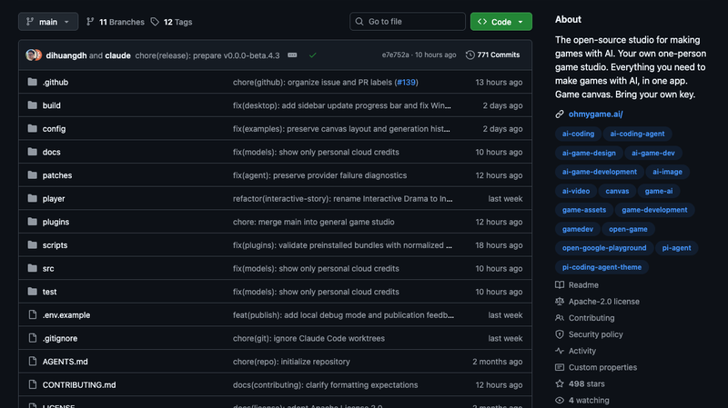

[OhMyGame](https://github.com/WhiteTowerAI/ohmygame)，498 Star，Apache-2.0。目标很直白：让一个人拥有完整的游戏工作室——从创意策划、美术素材生成、游戏编程，到自动试玩、调试和发布，**尽量在同一个应用里完成**。产物是一个可分享的网页链接。BYOK（自带 API Key），不做按次计费。

技术上有个值得注意的选择：它的 Agent 内核**就是 Pi**（`@earendil-works/pi-coding-agent`），完整跑 Pi 的工具集和持久会话，外面套一层 GUI——本质上是一个"Pi 的游戏垂直封装"，而不是自研 Agent。外层是 Electron 43 + React 19 + Vite，加一个 Node 22/Fastify 的本地 daemon；MCP 通过 `pi-mcp-adapter` 接入。

全流程靠三根支柱串起来：**一是**带 GUI 的完整 Pi Agent；**二是"一切皆文件"**——设计文档是 Markdown、画布和资产是同一套 JSON 节点模型、故事是磁盘上的节点图，全都配了 `AGENTS.md` 和 Schema；**三是"游戏即工具调用"**——试玩用 `game_use`、媒体生成也都是普通 Pi 工具，所以能在一次对话里把整条链走完。编排逻辑放在 Game Studio 插件里，含三个 Skill：编排（game-studio）、架构（game-foundations）、试玩验证（game-qa）。

内置四个引擎插件：Web 游戏走 **Three.js / React Three Fiber / Phaser**，**Godot** 通过 MCP 连接真实编辑器，另有自研的 Playable Nodes 交互式故事运行时，以及一个引擎无关的通用工作区。目前的短板也明确：Beta 阶段、试玩还是开环（批量输入跑完看结果，没有实时反射）、不支持 Unity/Unreal。

### ArtCraft：用 Rust 净室重写整个 Adobe 全家桶


[ArtCraft](https://getartcraft.com)，GitHub 组织 `storytold`。这一次不是"又一个 GIMP"，而是**用纯 Rust 净室重写（clean-room reimplementation）的 Adobe 软件替代品**，而且每个应用都是独立仓库——数据增长快得惊人，创建不到两周：

| Craft App | 对标 | Star |
|---|---|---|
| **PhotoCraft** | Photoshop | **41,880** |
| **LightCraft** | Lightroom | 8,967 |
| **FilmCraft** | Premiere Pro | 8,601 |
| **PdfCraft** | Acrobat | 7,908 |
| **VectorCraft** | Illustrator | 6,125 |
| **EffectCraft** | After Effects | 4,529 |
| **DesignCraft** | InDesign | 2,533 |

技术栈是**纯 Rust**（引擎、文档模型、渲染）+ egui 做 UI + wgpu 做 GPU 合成 + WebAssembly 网页版，覆盖 macOS/Windows/Linux/FreeBSD/Web，并且**Agent 原生**（自带 MCP server，可被 Claude 驱动）。许可为 MIT OR Apache-2.0 双许可。

设计取向很清楚：**复刻 Adobe 的布局、工具、菜单和快捷键**——"如果你会用 Photoshop，你就已经会用 PhotoCraft"，借此绕开 GIMP/Inkscape 的学习成本问题；同时通过 OpenRaster(.ora) 和 SVG 与 GIMP/Krita 互通。技术路线上他们刻意**不使用 GIMP、darktable 等 GPL 代码**（净室实现 + 宽松许可，规避 GPL 传染）。需要提醒的是**全部应用都还是 alpha**：PhotoCraft 自认"尚不能替代日常专业工作"（缺生成式 AI、还差 15 个工具和插件系统），VectorCraft 约 88% 功能面、可投入真实工作约 65%，EffectCraft 最年轻（首提交 2026-10-01，打不开 `.aep`）。

### ExplainDB：把数据库内部原理做成教材

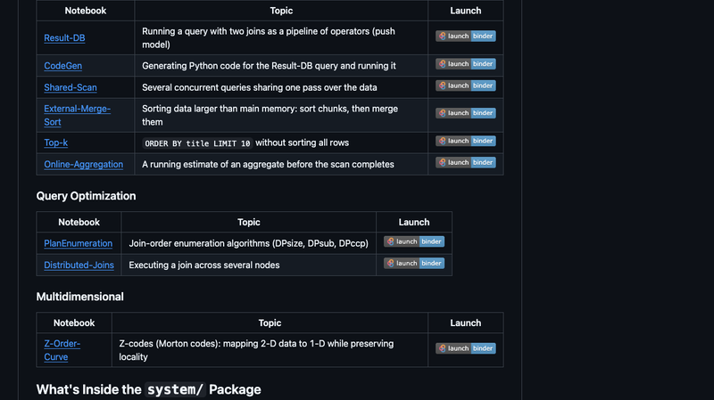

[ExplainDB](https://github.com/explaindb/explaindb)，158 Star，AGPL-3.0。来自萨尔大学 Jens Dittrich 教授的团队，是一套数据库系统课程教材：**Jupyter Notebook 讲义 + 一个真正能运行的 Python 教学型小型 DBMS**。README 里的自我定位很诚实——"**为阅读而生，不为性能而生**"。

覆盖的原理相当全：**B+ 树**有专门的 Notebook 分步可视化构建（分裂、叶链）；**MVCC** 在 `system/stores/` 下实现了 VersionedKeyValueStore / MVCC / IndexedMVCC，测试覆盖脏读、丢失更新等异常；WAL 没有独立章节，但日志思想体现在版本化存储的 journaling 里。此外还包括行存/列存、存储层次、RAID 0/1/4/5 的成本建模、位图与布隆过滤器、基数树、**学习型索引 RMI**、查询算子树与下推模型、代码生成、共享扫描、外部归并排序、Top-k、在线聚合、连接图与计划枚举（DPsize/DPsub/DPccp）、代价与基数估计、分布式连接，以及 Z-order 曲线。

实现语言是 Python 3.12，环境用 uv 管理，支持 Binder 零安装在浏览器里直接跑。适合数据库课程的学生、以及喜欢"读源码学原理"的工程师——不适合只想学 SQL 应用或者需要生产级数据库的人。

### shaders：WebGPU 特效当成组件用

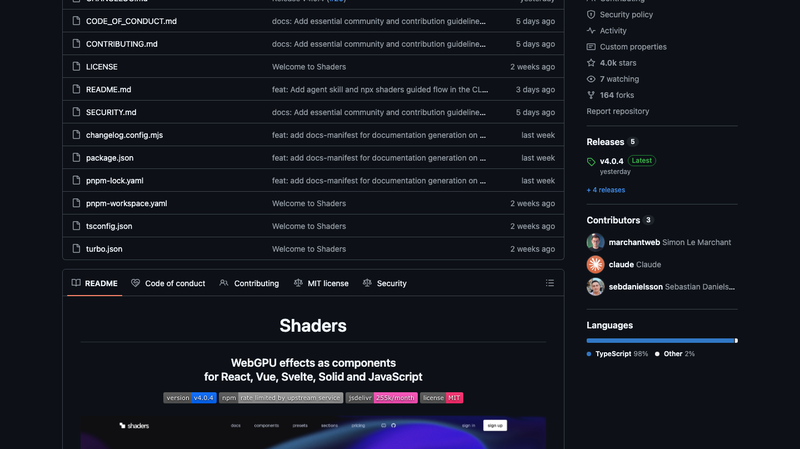

[shaders](https://github.com/shader-effects-inc/shaders)，4,005 Star。把 WebGPU 特效打包成**组件**：200+ 种效果，包括渐变、噪声、玻璃、金属、光、扭曲、过渡、模糊、光标效果，可以随意嵌套、混合、遮罩。一句 `npm install shaders` 就能用。

API 设计得很干净：`<Shader>` 负责渲染 canvas，**它的 children 就是图层**，从上到下依次求值并在 GPU 上混合——也就是说特效是声明式写出来的，不需要自己管理着色器管线：

```jsx
import { Shader, LinearGradient, CursorTrail } from 'shaders/react'
```

它同时提供 React、Vue、Svelte、Solid 和原生 JavaScript 的一等入口，所有框架共享同一套 props。工程上也是生产级的：TypeScript 编写、带类型的 props 支持响应式更新、SSR 安全。README 说已被 16,000+ 设计工程师用在数千个网站上。

比较有意思的是配套的**设计编辑器**：在 shaders.com 的无限画布上可视化调效果，然后**导出对应框架的精确组件树**——免费。这解决了一个很实际的痛点：设计师调出来的效果，通常要靠工程师手写着色器复现；而这里两侧用的是同一套组件模型，从设计到代码没有翻译损耗。

### PixelRAG：在像素空间里做检索

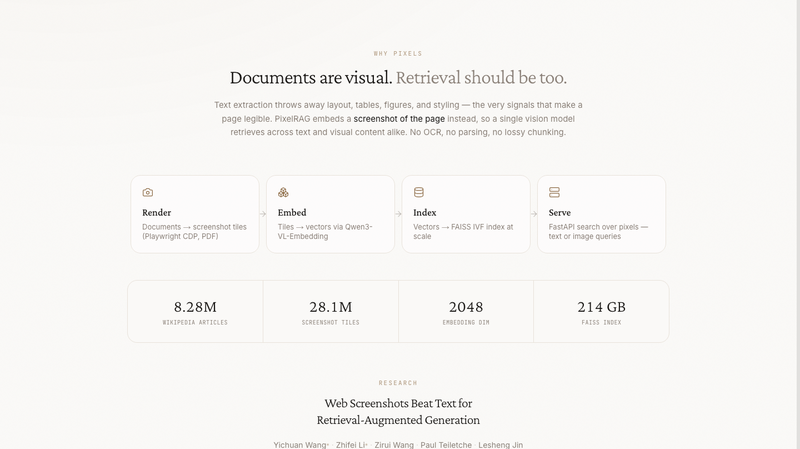

[PixelRAG](https://pixelrag.ai/)（[论文](https://arxiv.org/abs/2606.28344)）。传统 RAG 处理网页和 PDF 时，第一步往往是把页面转成文本——但表格、图片、排版一丢，原本的信息结构也跟着没了。PixelRAG 换了个思路：**不解析文本，直接把页面渲染成截图，在像素空间里完成检索和阅读**。

论文里的做法是端到端的：用 **Qwen3-VL-Embedding** 作为基础视觉嵌入模型，专门在截图数据上用精心构造的对比学习数据微调；检索到的截图**直接作为像素输入喂给 VLM**，中间不做任何文本转换。这消除了整条"HTML 解析 → 线性化"的管道。

规模上它做到了（据作者称是第一个）在**完整 Wikipedia 语料**上以这种形式运行：数据存储扩展到 **3000 万张截图**，配一个高效的视觉检索索引。效果上，它稳定优于"不检索"和"文本 RAG"两类基线——最让人意外的是**在 NQ、SimpleQA 这类以文本为中心的任务上也赢了**，也就是说保留视觉信息并没有牺牲纯文本场景的性能，反而带来了收益。

这条路线值得关注的地方在于：网页本来就不是纯文本的，而我们为了让 LLM 读懂它，一直在做有损转换。如果视觉模型足够强，"看页面"可能比"读文本"更接近人类获取信息的方式。

### Archify：把任何想法变成可交互的可视化

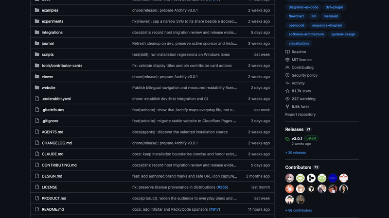

[Archify](https://github.com/tt-a1i/archify)，**81,651 Star**，MIT，最新 3.0.1（2026-09-28）。定位一句话："把你想要理解、规划或分享的任何东西，变成一张可交互的可视化。"

用法是 Agent 原生的：从**一个想法、一个问题或一个计划**开始，向你的 AI Agent 描述它，Archify 会把它变成一个可探索、可定制、可分享的**交互式 HTML**——不只是静态图。官方举的例子从旅行行程、学习地图到复杂系统，跨度很大。它作为 Agent Skill 分发，支持 Claude Code、Codex、Cursor、OpenCode，在 skills.sh 上有 130K+ 次安装，文档提供简体中文和日文版本。

它想解决的问题是实际存在的：让 AI Agent 画架构图，常见结局只有两种——要么是 Mermaid 那种"能看但乱"的自动布局，要么是让大模型直接生成图的"开盲盒"（图可能纯属编造，也没法验证）。Archify 走的是**渲染 + 验证**的路子，把图的生成变成一个可检查的过程，而不是一次性抽奖。项目免费开源，README 也明确区分了官方与第三方服务的界限。

### floorplan-3d：一个 index.html 的户型设计工具

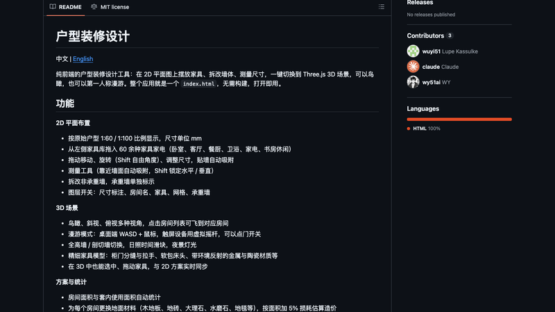

[floorplan-3d](https://github.com/wy51ai/floorplan-3d)，2,111 Star。纯前端的户型装修设计工具：在 2D 平面图上摆放家具、拆改墙体、测量尺寸，一键切换到 Three.js 的 3D 场景——可以鸟瞰，也可以第一人称漫游。最让人意外的是：**整个应用就是一个 `index.html`，无需构建，打开即用**。

2D 部分做得相当完整：按原始户型 1:60 / 1:100 比例显示（单位 mm），左侧家具库有 60 余种家具家电（卧室、客厅、餐厨、卫浴、家电、书房休闲），拖动移动、Shift 自由角度旋转、调整尺寸、贴墙自动吸附；测量工具靠近墙面自动吸附、Shift 锁定水平/垂直；还能拆改非承重墙（承重墙单独标示），图层开关可以分别控制尺寸标注、房间名、家具、网格、承重墙。

3D 场景是它区别于普通户型图工具的地方：鸟瞰/斜视/俯视多视角，点房间列表直接飞过去；漫游模式在桌面端用 WASD + 鼠标、触屏用虚拟摇杆，还能点门开关；全高墙与剖切墙切换、日照时间滑块、夜景灯光。家具模型有细节——柜门分缝与拉手、软包床头、带环境反射的金属与陶瓷材质。**3D 里也能选中拖动家具，与 2D 方案实时同步。**

统计和方案管理也很实用：房间面积与套内使用面积自动统计；给每个房间换地面材料（木地板、地砖、大理石、水磨石、地毯），按面积加 5% 损耗估算造价；撤销/重做、方案自动存浏览器本地、中英文界面切换、导出 PNG、导入导出方案 JSON。一个单文件 HTML 能装下这些，工程量比外观看起来大得多。

### Triple-A Minesweeper：把扫雷包装成 3A 大作

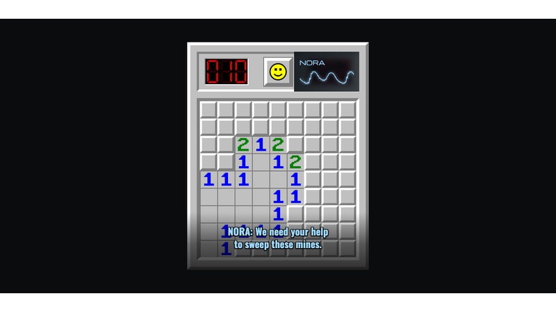

[Triple-A Minesweeper](https://minesweeper.mikelacher.com/)，作者 Mike Lacher，HN 1353 分。打开它你首先看到的是 Win95 的青绿桌面和一个快捷方式图标；双击之后，**Unreal Engine → NVIDIA → Bink Video → Wwise** 四个大厂开场 Logo 接连播过，然后是电影化的 "MINESWEEPER" 标题卡，接着来一段仿"主角从昏迷中苏醒"的模糊过场——最后进入一个 **9×9 的扫雷盘面**。

玩法 100% 是经典扫雷，其余的**全是戏**：右上角有 NVORA 通讯面板（带声波动画），底部滚动字幕，**全程真人配音**，还有一套狗血谍战剧情（暧昧联络人、黑帮债主等 NPC）。踩雷有红晕特效加惨叫，通关后会滚一份上百人的假演职员表，唯独 "Creative Director: Mike Lacher" 是真的。

技术上出乎意料地朴素：**原生 JavaScript（ES Modules），零框架、零 3D 引擎**。模块划分清晰——`board.js` 是扫雷逻辑、`view.js` 负责渲染（数字用 Canvas 画数码管）、`audioEngine.js` 用 Web Audio API、`director.js` 调度台词；动画走 CSS/Web Animations API；文案和代码完全分离（`data/*.js` 全是可编辑配置）。甚至还有彩蛋参数 `?skipto=ending|credits` 可以跳过游戏直接看结局。

它好笑的地方在于**极致的反差**：用虚幻引擎和 NVIDIA 的开场做一部 9×9 扫雷，而且所有宏大叙事都一本正经地为"你必须扫这些雷"服务。零门槛 + 怀旧 + 极高的完成度，让它成为那种打开就懂、截图就能传播的作品。

### Whistle：16.9MB 的语音转文字

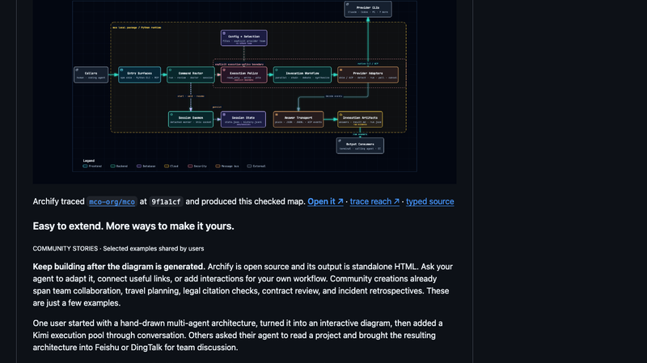

[Whistle: Speech to Text in 16.9 MB](https://cactuscompute.com/blog/whistle)，Cactus 官方博客，HN 946 分。整个模型就是**一个 16.9MB 的文件**，纯 CPU 运行、零依赖，和 Cactus 的 Needle 系列共用同一套 C++ 引擎、容器和量化方案。

架构是 Encoder–Decoder，大量复用 Needle 的代码块。前端处理：16kHz 单声道 → 80-bin log-mel → 卷积 stem → 375 帧（每帧 80ms）。Encoder 是 **8 个 Simple Attention block**（4 个残差通道 + 用 Monarch Hadamard MLP 替代 FFN，非因果注意力）；Decoder 是 8 个 Laddered Simple Attention block，宽度 512，**GQA 8q:2kv**，3-tap 因果卷积，每层一个 gated cross attention 读 encoder。解码用 **beam search × 5** 加 Aho-Corasick 关键词偏置，词表 8,192 token 加 7 个语言 token，支持 2–8 层深度的阶梯式加载。

性能数据（Apple M4 Pro CPU）：**首 token 仅 11.1 毫秒**（10 秒片段；5 秒片段 5.9ms），解码速度 **1,319 token/秒**。对比之下：

| 指标 | Whistle | Whisper base | Moonshine tiny v2 |
|---|---|---|---|
| 体积 | **16.9 MB** | 145.3 MB | 41.9 MB |
| 首 token | **11.1 ms** | 73.2 ms | 22.8 ms |
| 解码 | **1,319 tok/s** | 266 tok/s | 262 tok/s |

体积只有 Whisper base 的 1/9，速度快 6 倍以上。精度上两者互有胜负：Whistle 在 LibriSpeech、SPGISpeech、Earnings-22、FLEURS 上领先，Whisper base 在 TED-LIUM、AMI、MLS 上领先。支持 7 种语言（英德法西意荷波）、词级时间戳和语音 embedding，预编译了 17 个平台——包括 watchOS、RISC-V、MIPS 和浏览器 WASM/WASI。配合同二进制的 Needle，还能一次完成"语音 → 直接 function call"。

### Yes, and：AI 时代还要不要当程序员

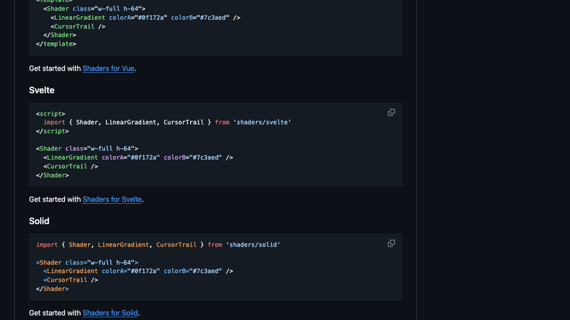

[Yes, and](https://htmx.org/essays/yes-and/)，htmx 作者 Carson Gross（蒙大拿州立大学 CS 教师）的文章，HN 767 分。需要先说明：**这篇跟即兴喜剧式的 Web 开发无关**，它是用即兴喜剧的第一原则——"接受搭档的设定，再往上构建，绝不否定"（Yes, and…）——作为修辞框架，来回答一个直白的问题：**有了 AI，我还该不该当程序员？**

他的回答拆成两半。**"Yes"**：程序员这个职业的价值依然成立，因为编程 = 用计算机解决问题 + **控制复杂度**，而这件事难以被 AI 取代。**", and…"**：但编程的方式正在改变，需要补充新的技能——沟通能力、理解业务、架构系统、高效使用 LLM。

文章里最被反复强调的是"**你必须亲手写代码**"。他的论证有两步：一是初级程序员如果直接拿 AI 生成的代码交差，会丧失对代码的**本能理解**，掉进"魔法师的学徒陷阱"——造出自己既不懂也控制不了的系统；二是反驳"AI 生成代码就像当年从汇编升级到高级语言"这个类比——**编译器是确定性的，LLM 不是**，而且 LLM 常常**增加**偶然复杂度（accidental complexity）。既然你最终必须能读懂代码，那就必须写代码。

他对 AI 的定位也很清楚：**"AI 是极好的助教"**——用来理解概念、绕过工具链的坑（他自曝当年在伯克利被 Unix 卡住而退学），而不是当代码生成器。他公开了自己配套的 `AGENTS.md`。至于求职建议，他说招聘网站对应届生就像买彩票，不如用"四个 F"（family、friends、friends of friends）借人脉入场，而且不一定非要去大厂。最后的呼吁是给公司的：**让初级程序员至少写一部分代码**。

### BIGWORDS.PAGE：链接就是整个显示屏

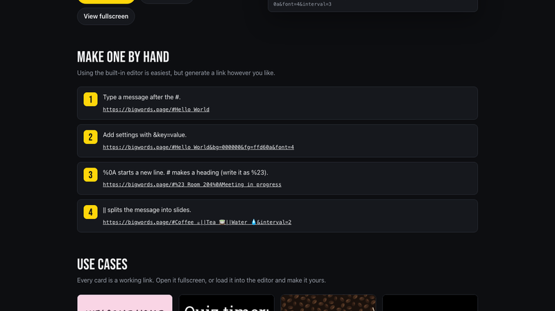

[BIGWORDS.PAGE](https://bigwords.page/)，HN 718 分。把任何屏幕变成标语牌：**链接本身就是整个显示内容**。

用法极简——一个 URL 就能做全屏标语、计时器或消息。举着手机在到达口接人、把倒计时放到电视上、在前台展示 Wi-Fi 密码。**不需要账号、不需要 App、服务器上什么都不存**，链接可以分享也可以收藏。URL 里用 `||` 分隔多页显示，支持 markdown 加粗（`**big.**`）和换行（`%0A`），比如：

```
https://bigwords.page/#Say%20it%20**big.**||Any%20screen.%0AAny%20size.
```

作者在 HN 上讲了它的由来，很有意思：他需要在一块**有远程管理控制、但没有任何物理接触**的平板上显示一条消息。把设备配成 kiosk 浏览器很容易，但问题是——怎么让浏览器显示他的消息？于是他把"消息"直接编码进了 URL。这个思路的美感在于：**当应用状态完全由 URL 表达时，任何能打开链接的东西都成了你的显示屏**，连"安装"和"登录"这两个环节都不需要存在。评论区有人已经开始想把它接到语音控制、放在车后窗跟别的司机"说话"了。

### "You said no MCP!"：一次体面的立场转变

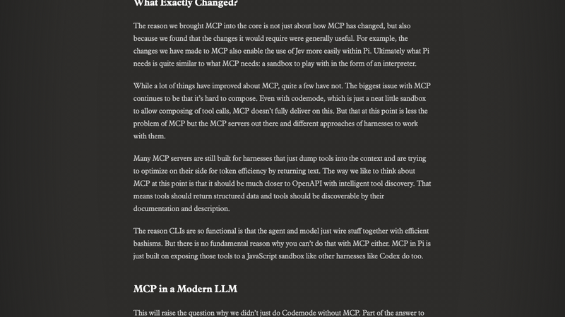

["You said no MCP!"](https://earendil.com/posts/you-said-no-mcp/)，Earendil（Pi 的开发方）的官方文章，HN 686 分、362 条评论。标题很诚实——他们曾经在 pi.dev 上骄傲声明"**Pi 不支持 MCP**"，在播客里也多次贬低过它。而现在升级 Pi，会发现 MCP 已经是核心功能。

他们的解释是"事物会变"：过去一年一直在关注 MCP，**今天的 MCP 已经不是去年的 MCP**。但这本身不足以让它进核心（它本来就是以扩展形式存在的）。真正的理由是：**为了让 MCP 进核心而必须做的那些改动，本身就有普遍价值**——比如让 MCP 与 Codemode 结合后，Jev 在 Pi 里也更容易使用了。他们发现 Pi 需要的东西和 MCP 需要的东西其实很像：一个可以玩耍的沙箱（以解释器的形式）。

文章也坦率承认 MCP 仍然存在的问题：**最大的问题依旧是难以组合**。即使有了 Codemode（一个允许组合工具调用的沙箱），MCP 也没完全做到这一点。不过他们认为这更多是 MCP 服务器的问题——很多服务器仍是为"把工具一股脑塞进上下文"的 harness 设计的，只是在自己那一侧优化 token 效率（返回文本）。

他们给出的方向是：MCP 应该更接近 **OpenAPI + 智能工具发现**——工具应当返回**结构化数据**，并且可以通过文档和描述被发现。CLI 之所以好用，是因为 agent 和模型能用高效的 bash 组合把东西接起来；而 MCP 在原理上没有任何理由做不到同样的事。

至于为什么要亲自下场而不是继续在边上看：**"正面影响一件事的最好方式就是拥抱它。"** 这种"当初反对、现在拥抱、并且把为什么改变讲清楚"的公开表态，在技术圈里并不多见，也因此获得了很多尊重。

## 订阅
这里会不定期分享我看到的有趣的内容（不一定是最新的，但是有意思），因为大部分都与机器有关，所以先叫它"机器文摘"吧。

Github 仓库地址：https://github.com/sbabybird/MachineDigest

喜欢的朋友可以订阅关注：

- 通过微信公众号"从容地狂奔"订阅。


