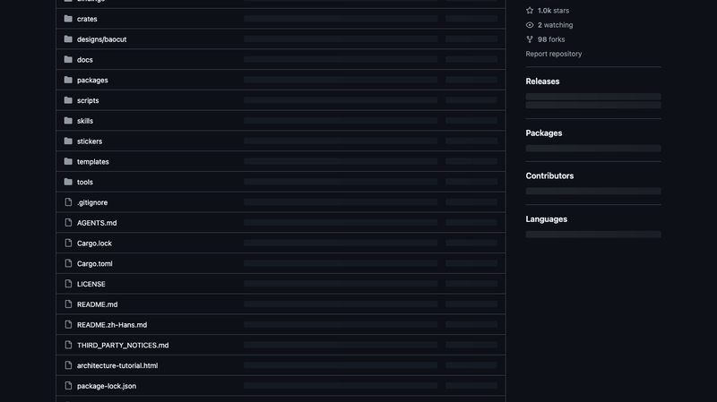
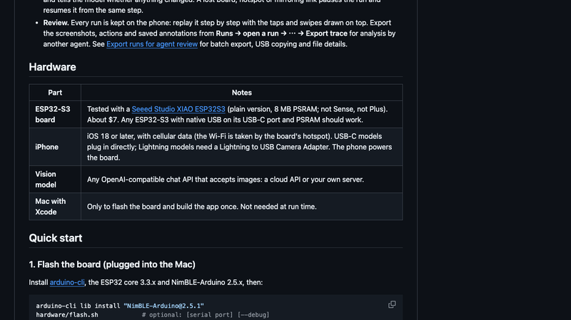
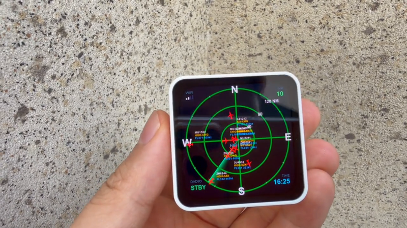
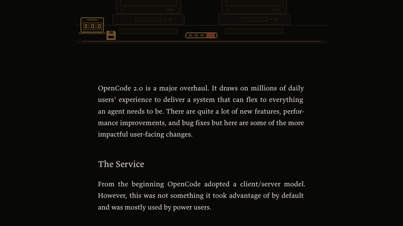
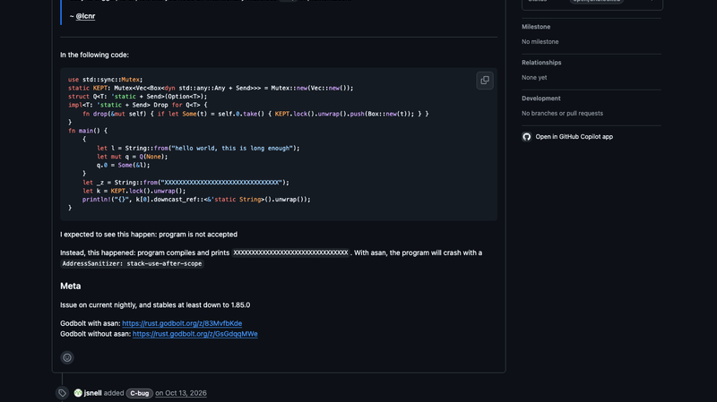
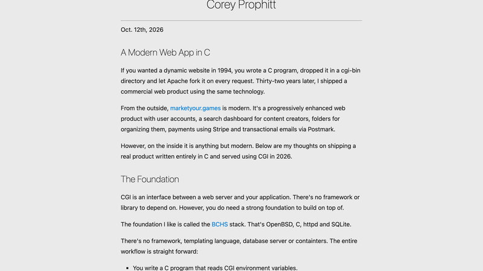
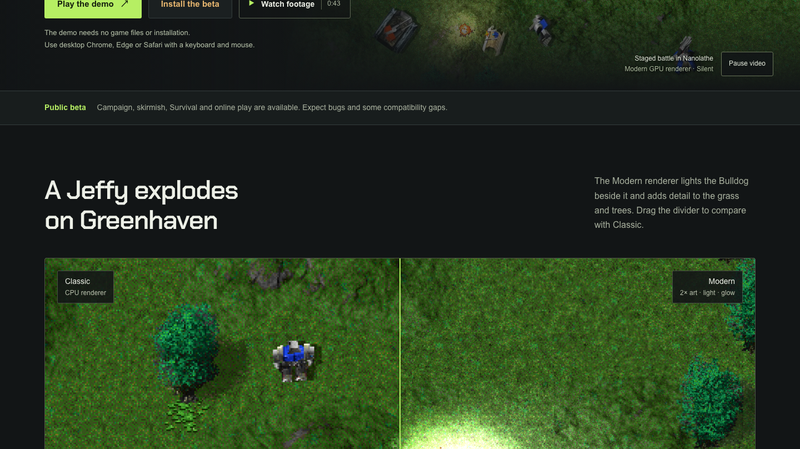
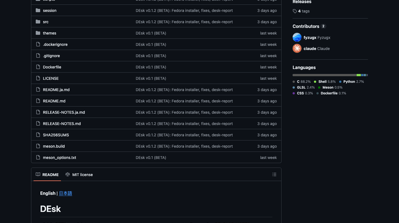
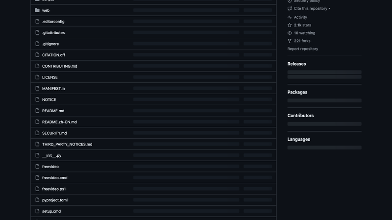
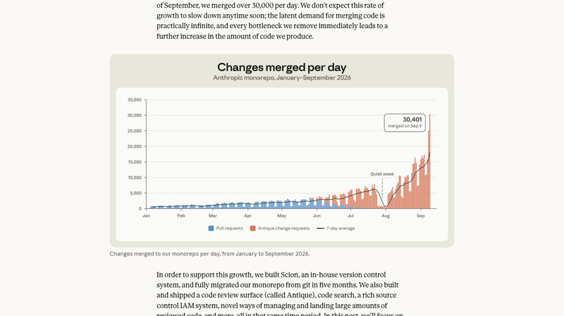

# 机器文摘 第 191 期

### VibeOffice：10 天、7.8 万行，AI 复刻的 Office 2003


[VibeOffice](https://github.com/tcchen2026/VibeOffice)，858 Star，Apache-2.0。浏览器里的 **Office 2003 风格三件套**，不用安装、不用账号、没有服务器，文件全部留在本机。建库到最后一版推送只隔了 **10 天**（10-08 到 10-17），100 次提交，**public 目录下 125 个 JS 文件、78,098 行代码**。

三个应用分别是 **Quire**（对标 Word：.docx/.docm/.rtf/.txt/Markdown，导出 PDF）、**Ledger**（对标 Excel：.xlsx/.xlsm/.csv/XML Spreadsheet）、**Lectern**（对标 PowerPoint：.pptx/.pptm，导出 PDF/PNG/HTML）。技术上**纯原生 JavaScript，零框架、零构建步骤**，经典 `<script>` 加载 + 单一全局命名空间 `window.L`，配严格 CSP（无内联脚本、无 eval、无 CDN）。

真正惊人的是完成度。它自建了一整套 OOXML 引擎：`opc.js` 处理保留型包图、`geometry.js` 支持 92 种 AutoShape、`metafile.js` 是自己写的 WMF/EMF 播放器、`numfmt.js` 兼容 Excel 数字格式、`crypto.js` 实现 ECMA-376 AES-256 加密。Ledger 实现了 **519 个工作表函数**（Excel 2003 全集加 Analysis ToolPak，外带 LET/LAMBDA/MAP/REDUCE/XLOOKUP 等新函数）、数组公式、动态数组、数据透视表、条件格式和图表向导。

最硬的功夫在**无损保存**：它直接在原始 OOXML 树上修改，**未触碰的部分逐字节写回**——VBA 宏、OLE 对象、SmartArt、音视频、墨迹全部保留，还带兼容性检查器。验证用了 4,697 个公开测试文件（来自 LibreOffice、Apache POI、Open XML SDK）跑开-存-改-撤销-恢复的循环。实测数据也很实在：889 个工作簿、1,649,147 个单元格，883 个值/公式完全一致；Word 文档 776,869 个字里保留了 776,207 个。

关于成本，微博上流传的"花了 1000 美元"是技术博主转述，作者本人在 V2EX 只说了"消耗了巨量 token"，没有公布具体数字。但仓库里的 `AGENTS.md` 透露了开发方式：*"这个仓库里有多个 agent 同时工作"*，要求每个 agent 只提交自己的文件和 hunk、绝不回滚他人未提交的改动——**多 Agent 并行 + 人工验收**，这也解释了为什么 100 次提交能产出 7.8 万行。

已知短板：不能执行 VBA（宏只保留不运行）、不支持旧版二进制 .doc/.xls/.ppt、PPT 内嵌视频会丢、CJK 排版仍有中英混排字体不一致等问题。

### BaoCut：可编辑视频才是真相源



[BaoCut](https://github.com/JimLiu/baocut)，1,048 Star。定位一句话：**"围绕一个可编辑的视频构建的 AI Agent，而不是一次性生成的 MP4。"** 告诉它你想要什么，它负责转录、加字幕、翻译、配音、剪辑和动画——**每个结果都落进一条可以继续编辑的时间线**。

它反对的做法很具体：大多数 AI 视频工具渲染一次就给你一个文件，如果译文第二句错了，你只能从头再来。BaoCut 的四个设计原则正好对着这个痛点：

- **视频是唯一真相源**：转录、翻译、字幕层、章节、配音、动态图形全部活在同一个可编辑视频里；SRT、MP4、音频这些文件是它的**导出物**，而不是反过来。
- **局部编辑保持局部**：修一行字幕、换一个镜头、重录一句配音，Agent 只改那一处，并给你一份"改了什么"的回执，其他内容不重新渲染。
- **人和 Agent 共享同一个编辑器**：你拖一个片段，Agent 重写一条字幕，两者走的是同一个命令网关、同一套事务、同一个撤销栈——你随时可以接管。
- **有界的自主性**：Agent 在明确的作用域、访问模式和预算内工作；破坏性操作会先询问；不可信的材料（下载的网页、转录文本）只当数据，绝不当指令。

形态是 macOS/Windows 桌面应用（打包了 Runtime 和原生 worker），Windows 还分 CPU / CUDA / Vulkan 三个版本适配不同显卡。本地模型默认从 Hugging Face 下载，也可以切到 ModelScope 镜像。需要接一个已登录的 Agent 引擎（Codex CLI 或 Claude Code），媒体分析、转录准备和导出还需要系统里装有 ffmpeg/ffprobe。"字幕改一行不用重渲染整条视频"——这个要求听起来简单，但它决定了整个架构必须是**可编辑的中间表示**，而不是一个渲染管线。

### esp32-iphone-agent：40 块钱让大模型操作 iPhone



[esp32-iphone-agent](https://github.com/onehumanbeing/esp32-iphone-agent)，**2,995 Star**（10-11 创建，一周内 3k），MIT（但 `src/airplay/` 是从 UxPlay 移植的 GPL-3.0 代码，所以固件实际按 GPL 分发）。传统 iOS 自动化依赖 Mac 和开发者证书，这个项目用一块约 40 元的 ESP32-S3 就绕开了。

技术上有两个关键点。**第一，不只是 USB HID 模拟，AirPlay 接收端是真的跑在板子上的**：固件移植了 UxPlay 的接收端，包含 mDNS 广播、RTSP 握手、FairPlay 密钥交换、AES-128-CTR 解密、AVCC→Annex-B 转换和 SPS/PPS 抽取，约 1000 行 C。**但板子不解码**——它只把 H.264 裸流搬运到 PSRAM（GOP 缓冲 4MB），再按 BLE MTU 切片转发给 iPhone App，由 App 用 VideoToolbox 解码成 JPEG。这是它能跑在 8MB PSRAM 上的根本原因。

**第二，"大脑"分成 planner 和 actor 双模型**，可以接任何 OpenAI 兼容接口，图片走 base64 data URL、强制流式。动作只支持 0–1000 的相对坐标，一次最多给 6 个动作以减少 LLM 往返，最多 40 步，连续 3 次相同动作就判定卡住并强制 replan。

闭环的实现很有意思，因为它**没有 UI 元素树，纯靠像素**：指针是相对坐标，所以要定期撞左上角归零；精确点击时先横向 nudge 12 个单位，用**前后帧像素差**找出指针质心并即时纠偏；最近 12 个落点做最小二乘直线拟合，越用越准。动作是否生效也靠像素差分判断（屏蔽状态栏和指针区域），结果以 "changed / NOT changed" 回灌给模型。

延迟：投屏 480×1040、≤5 fps，BLE 300–500 kbps 是最窄的瓶颈；实时流取帧不到 1 秒，单步动作几秒（大头是模型），precise 点击再加约 1 秒。局限也很清楚：锁屏即断投屏、密码/Apple Pay/DRM 页面不投（无法无人值守）、占用 Wi-Fi 所以模型得走蜂窝、用了私有 API 上架无望、仅 ASCII 仅竖屏、刷机需要 Mac + Xcode 且免费证书 7 天要重签。**没有元素树意味着上限被视觉模型的定位能力硬性锁死**——但它证明了：一块十块钱级别的 MCU，加一套认真的工程，就能让大模型直接操作一台真手机。

### ESP32 塔台雷达：一块开发板播报天上飞过的飞机



B 站 UP 主「电磁波Studio」的《我用 ESP32 做了个塔台雷达》(BV1Cjpq6iE8b)，配了一个开源仓库 [esp32-radar](https://github.com/emwstudio/esp32-radar)。设好中心坐标、连上 WiFi，**有飞机路过它就用塔台调度员的音色自动播报**。

硬件是一块微雪的 **ESP32-S3-Touch-AMOLED-2.16**（约 30 美元）：ESP32-S3R8 + 8MB OPI PSRAM + 16MB Flash、480×480 CO5300 AMOLED 屏（QSPI）、CST9220 触摸、ES8311 DAC + ES7210 ADC + 功放 + 喇叭、AXP2101 电源管理，外壳是 3D 打印的白色方盒。

技术实现里有几个点比视频描述更值得说：

**航班数据源不是 ADS-B，而是飞常准的 MCP 服务**。因为飞常准没有地理围栏查询，作者只能以杭州萧山机场（HGH）为枢纽扫 8 条航线（每 5 分钟 16 次调用）拿到机尾号，再逐架轮询位置（45 秒一次，最多跟踪 12 架，10 分钟失联就移除）。

**播报音色是 VoxCPM2 的零样本克隆**，走面壁开放平台的语音接口——参考音频是作者自己准备的 9 秒真实塔台录音，通过 base64 的 `ref_audio` + `ref_text` 传进去。作者说可以本地部署，但固件实际调的是云 API。SSE 流里抓 `"audio"` 分片拼成 WAV，靠 `speech.audio.done` 判断完整性，截断就重试三次。

**播报文案由 MiniCPM5-2B 生成**，8 种塔台风格按进近/离场/过路选池随机，控制在 25 字以内；航班号的航空读法（"幺两拐洞"）在**设备端做确定性转换**，LLM 输出为空时还有重试加本地模板兜底，同一机尾号 15 分钟内不重复播。

**"电台味"是手工调出来的**：0.9 倍采样率降速 + 300Hz~3kHz 带通滤波 + tanh 软削波 + 极轻底噪。雷达界面用 LVGL 9 画矢量圆环和刻度，canvas 做扫描余晖，40/80/120 海里三档距离环，标出萧山跑道的磁方位线，飞机图标按航向旋转并带三色标签和品红速度矢量，四角显示 WiFi 状态、架数、时间和 RADIO 状态。

几个坑：仓库默认 `SIM_FLIGHTS 1`（本地模拟 10 架飞机、6 倍速、不花钱），要真数据得改成 0 并填两套 API Key；必须 8MB PSRAM 才跑得动（1.5MB 响应 + 1.4MB WAV + LVGL 双缓冲），C3 那类板子不行；配网方式是连它开的热点 `HGH-RADAR`，在 192.168.4.1 填 WiFi 和中心 GPS 坐标。

### OpenCode 2.0：把 Agent 变成一个服务



[OpenCode 2.0](https://anoma.ly/notes/opencode-2-0/)，HN 884 分。这是一次大改版。最有结构性的一条：**那个一直存在的 client/server 架构，终于变成了默认形态**。

2.0 里那个 server 会自动作为**单个后台进程**运行。你打开 TUI、Web 界面或桌面 App，它们**都跟同一个中心进程通信**——会话、任务、状态是共享的，而不是各开各的。用 `@opencode/client` 写脚本时会自动发现本地服务；也能用 `opencode api` 从命令行调用；甚至可以用 `/pair`（`opencode pair`）把它暴露给其他主机、接入别的应用。官方说原生 App 也在路上。

**API 是彻底重写的**。文章写得很坦白：旧 API 是"我们和这个世界一起学习 Agent 是什么的过程中，杂乱地长出来的，它很糟糕"。于是他们从头开始，把数百万日常用户的各种奇怪用法都过了一遍——新版几乎能支持你需要的任何操作。

有一个细节很能说明设计方向：**OpenCode 知道自己的 API，并且会主动调用它**。比如开始一项新工作时，它会调用 `worktree_create` / `session_move` 把当前会话挪进一个 git work tree，再 `session_rename` 改成合适的标题——这些对用户是透明的。

**Code Mode** 是另一个重点。"模型天生爱写代码"，所以 2.0 比任何其他 coding agent 都更彻底地利用这一点：`@opencode/codemode` 里实现了一个**极简 JavaScript 解释器**，把 MCP server 或 OpenAPI 端点**转换成 agent 可以在脚本里调用的函数**（例如 `tools.github.list_issues`、`tools.linear.save_issue`），然后让模型直接写 JS 来编排：

```js
const { issues } = await tools.github.list_issues({
  owner: "anomalyco", repo: "opencode", labels: ["bug"], state: "OPEN",
})
const filed = await Promise.all(issues.map(({ title }) =>
  tools.linear.save_issue({ team: "OC", title })))
return filed.map(issue => issue.identifier)
```

也就是说：与其让模型一个工具一个工具地串行调用，不如让它写一段脚本，在沙箱里一次性把多个工具组合起来跑完。

### Rust 借用检查器里一个 11 年的 soundness bug



[rust-lang/rust#164250](https://github.com/rust-lang/rust/issues/164250)，HN 746 分。标题是"**结构体的生命周期要求可以通过协变字段赋值绕过**"。

最小复现是这样的（简化）：一个 `Q<T: 'static + Send>(Option<T>)`，它的 `Drop` 实现会把内部值 box 起来塞进一个全局的 `Mutex<Vec<Box<dyn Any + Send>>>`（这要求 `'static`）。然后：

```rust
let l = String::from("hello world, this is long enough");
let mut q = Q(None);
q.0 = Some(&l);   // 把一个非 'static 的引用塞进了要求 'static 的类型
```

这段代码**编译通过**，而且不是无害的：配合 `downcast_ref::<&'static String>()` 读出来，打印的是已经被复用的栈内存；开 ASan 会直接报 `stack-use-after-scope`。影响范围至少回溯到 **Rust 1.85.0**。

Rust 类型团队在 issue 里加了说明，态度值得称道：他们承认这是 `P-high`（本来该是 `P-critical`），而"只"定为 P-high 的唯一原因是**这个 bug 已经 11 年了**——11 年都没在真实代码里被撞到，说明它其实很难触发。他们还指出，要利用它**需要故意写一个恶意的 `Drop` 实现**，所以这个 unsoundness 很可能从未意外造成内存不安全。团队同时列举了正在推进的下一代 trait solver、region constraint 重构和 Project Zero，目标是把这类未知风险压到最低。

Alan Kay 说过一句被 Rust 团队反复引用的话："简单的东西应该简单，复杂的东西应该可能。"把一个 11 年前的洞补上，是这句话的日常实践。

### A Modern Web App in C：回到 CGI



[A Modern Web App in C](https://prophitt.me/writing/a-modern-web-app-in-c)，HN 714 分、326 条评论。核心结论一句话：**没有 HTTP 库、没有模板引擎、没有路由框架——他回到了 CGI。**

技术栈是 **BCHS**：OpenBSD + C + httpd + SQLite。应用就是一个 CGI 程序：每个请求 fork 一个新进程，读环境变量、往 stdout 写响应。因为 httpd 直接调 CGI，nGINX→应用服务器那种两层结构就消失了；libcurl 只用来对外调用 Stripe/Postmark。

几个刻意的"减法"：**没有模板语言**，HTML 直接在 C 里拼（理由很实在——避免 Go template / Jinja 这类"双语言文件"把编辑器高亮搞崩），静态资源在构建时直接编进二进制；**路由**就是手写 dispatch，解析 method/query/header/body 后分派。Cookie 解析、query/表单校验、输出转义全塞进一个自己写的单头文件 `cgi.h` 里——作者自己也不太满意，提到过 kcgi，但不愿绑死它的 API 和安全模型。安全上：SQLite 直接开文件（vendored amalgamation），libsodium 做密码哈希、Cookie 加密和 HMAC，libcjson 单文件 vendored；真正的构建依赖只有 libcurl 和 libsodium。沙箱靠 OpenBSD 的 pledge/unveil 加 httpd 默认的 chroot。

部署方式是这套方案最舒服的地方：`Makefile` 编出静态二进制，**丢进 cgi-bin 即完成发布**——换二进制就上线，不用重启、不用停机；clean build 几秒，增量构建不到 0.5 秒。规模上去了再换 FastCGI。

至于为什么用 C，作者的回答更多是"为什么不用重栈"：基础而非框架（CGI 1.1 从 2004 年至今没变，只需要懂四个 HTTP 概念）、关注点清晰且能用 gdb/管道像本地程序一样调试、供应链极小（编译器 + 3 个库）、工具极简（零插件 Vim、无 LSP、无 AI，一堆 C 文件和 Makefile）、SQLite 零运维、fork 在现代内核上已经不算贵。

HN 上的质疑也很到位：1994 年的 cgi-bin 里跑的是 Perl；并发写 SQLite 怎么办；既然极简为什么不自己写 HTTP server（作者回答：HTTPS 交给反向代理）。**这篇的价值不在于推荐大家回去写 CGI，而在于提醒：当代 Web 栈的复杂度里，有多少是我们真的需要、有多少只是习惯。**

### Nanolathe：让《横扫千军》在现代电脑上重跑



[Nanolathe](https://nanolathe.gg)，HN 698 分。1997 年的即时战略神作《横扫千军》（Total Annihilation）有了一个开源引擎：直接加载**原始游戏的地图、单位和战役**，在 Windows / Mac / Linux 上运行。官网上还能直接玩一个**三关的浏览器 demo**——不需要游戏文件、不需要安装。

工程上最花心思的是渲染。它做了一套现代 GPU 渲染器，与经典 CPU 渲染器可以拖动分隔线实时对比：**2× 合成美术、光照、辉光**。细节很实在——tile cache 是从原版游戏的 32×32 瓦片**合成**成 64×64 的，树木精灵用 2× 合成的特征库，地形和植被都是重新生成而非简单放大。截图里同一时刻对比，Modern 模式下草地和树木的层次明显不同。

功能上目前是公开 Beta：战役、遭遇战、生存模式和在线对战都已可用，但作者也明说会有 bug 和兼容性缺口。HN 评论区很有意思：有人感慨"AI 辅助的反编译、重制、逆向移植和自制游戏速度快得离谱"，甚至调侃 GTA VI 会不会在 PS5 发售后几天就被人"PC 版发布"；也有人推荐 **Beyond All Reason** 这个精神续作（开源、打磨得相当好）；还有人问《横扫千军：王国风云》会不会被支持。

### DEsk：一张会做事的胡桃木桌子



[DEsk](https://github.com/fyzugx/DEsk)，689 Star（HN）。一个 Linux 的 Wayland 桌面环境，做的是**真实感的拟物化**——就是 iOS 6 那种"屏幕上所有东西都画得像真东西"的风格。这一次，**桌面就是一张桌子**。

具体到细节：**窗口是胡桃木桌上的纸页，dock 是抽屉，你的应用是身后书架上的活页夹，通知出现在信箱里，系统控制是桌子背面内置的一块面板**。整个房间是**光线追踪**渲染的，而且只有一盏台灯照亮全部。README 里那张截图能看到：两份"程序"摊在纸上、桌面时钟、左后方是控制面板、右后方是信箱。

名字是双关——**D**esktop **E**nvironment 加上 **desk**，来自 Reddit 社区的建议（原名 DeskWM，命令、配置和数据都会自动迁移）。目前 v0.1.2 Beta，提供 Debian 13、Ubuntu 24.04/26.04（以及 Mint、Pop!_OS）的安装脚本和 Fedora 安装器，作者说这是在他自己的机器上日常在用的版本，架构文档写得很细，但毕竟是第一个公开版本，会有粗糙的地方。

在一个所有桌面都在追求"扁平"和"无摩擦"的年代，花力气把窗口做成纸、把通知做成信件，本身就是一种表达：**界面可以不只是信息容器，也可以是一个你愿意待着的房间**。

### FreeVideo：8GB 显存本地跑 MiniMax H3



[FreeVideo](https://github.com/FlashML-org/FreeVideo)，2,054 Star。定位很朴素："**在你已经拥有的电脑上做视频**"。基于 OpenVDN 的 8 步 VDN-H3 模型（Video DeltaNet 的混合注意力），**最低 8GB 显存 + 16GB 内存**就能本地跑 MiniMax H3。

核心是它那套**硬件自适应执行**：给每块 GPU 选合适的权重格式（GeForce 和 RTX 30 系用 int8，工作站和数据中心卡用 FP8），并自动探测可用的注意力 kernel。低内存推理靠三招——**权重流式加载、异步预取、分块计算**，把峰值内存压下来。它同时协调显存、系统内存和磁盘这三层，动态决定权重放在哪。形态是 ComfyUI 插件，带 Windows / macOS / Linux 启动器，支持文本提示、首尾帧、图像/视频/音频参考。

更新节奏很快：v0.3.0 换 int8 后，RTX 3090 生成 5 秒视频快约 2.3 倍；v0.3.2 加了"先看半分辨率预览，喜欢哪个再渲染完"；v0.4.0 支持让 Claude Code 或 Codex 这类 Agent 自己生成视频、做一分钟以上的长视频、并在时间线上编辑。还有一个很贴心的设计：**视频会携带自己的工作流**——把 FreeVideo 生成的视频拖到 ComfyUI 画布上，能恢复它的 prompt、seed 和设置。对没有大显存卡的人来说，这是把"本地视频生成"从不可能变成可用的那类项目。

### Anthropic 用 5 个月换掉了 git



[Redesigning source control at Anthropic](https://www.anthropic.com/engineering/redesigning-source-control)，HN 892 分。开头就把处境说清楚了：**当代码不再是瓶颈，瓶颈就变成了所有为人类规模设计的开发基础设施**——源码控制、构建、CI。

数字很直观：2026 年 5 月，Anthropic 平均每天合并约 **2,500** 个代码变更；到 9 月，这个数字超过了 **30,000**。他们不认为增速会放缓——"对合并代码的潜在需求几乎是无限的，每移除一个瓶颈，代码产量立刻再上一个台阶"。

于是他们自建了 **Scion**，一个内部版本控制系统，**5 个月完成了整个 monorepo 从 git 的迁移**。同期还做了代码评审界面 Antique、代码搜索、富 IAM 系统，以及管理大规模已评审代码落地的新方法。

为什么 git 撑不住？作者的诊断很精准。他们的主分支历史就有近 **100GB**，压缩后的工作副本超过 **25GB**；每天约 **2,500 万次代码 checkout**（仅 CI，不算开发环境、agent 沙箱和研究任务）——如果朴素地抓取，一天就是 **600PB** 的 git 流量。他们用尽了 git 的现有手段：浅克隆、稀疏检出、promisor remote、内部镜像（峰值时跑着几百个 git 镜像）、blob 存储里的仓库快照（seeds）。这些"买来了时间"，但随着合并率上升越来越难运维：seed 每次刷新离 main 的 tip 越来越远，依赖历史的操作（diff、blame）在部分克隆上越来越难保正确。

最关键的一段洞察是：**"像大多数公司一样，我们把 git 当中心化系统用——一个权威副本；但我们几乎所有的客户端都是 agent 和 job，它们天然是在线的。"** 换句话说，git 最引以为傲的那些属性（每个 clone 都是完整自包含仓库、能离线算 diff、读历史、做 blame、切任意版本），恰恰是他们完全不需要的。当客户端从"人"变成"成千上万个永不离线的 agent"，为分布式设计的工具反而成了负担。

这篇文章值得读的地方不只是 Scion 本身，而是它给出的信号：**AI 写代码的速度正在把软件工程的每一个传统假设逐个撑破**，而版本控制只是第一个。Anthropic 说他们不指望其他组织近期就遇到这些问题，但"用 AI 编码工具的人不会太久就会撞上同样的压力点"。

## 订阅
这里会不定期分享我看到的有趣的内容（不一定是最新的，但是有意思），因为大部分都与机器有关，所以先叫它"机器文摘"吧。

Github 仓库地址：https://github.com/sbabybird/MachineDigest

喜欢的朋友可以订阅关注：

- 通过微信公众号"从容地狂奔"订阅。


