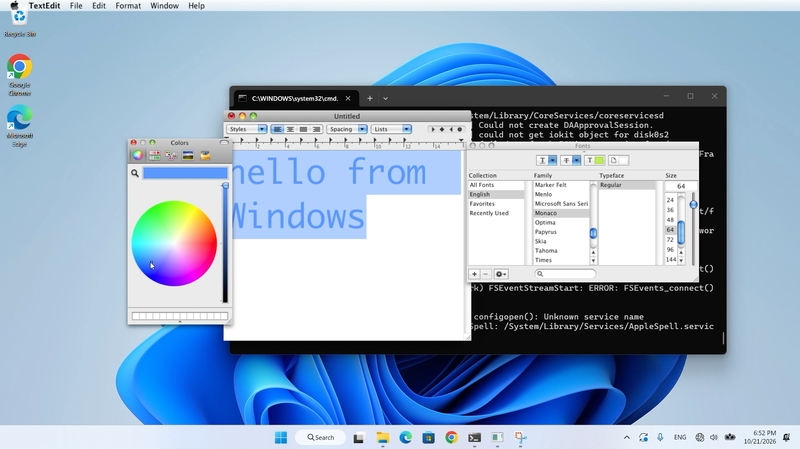
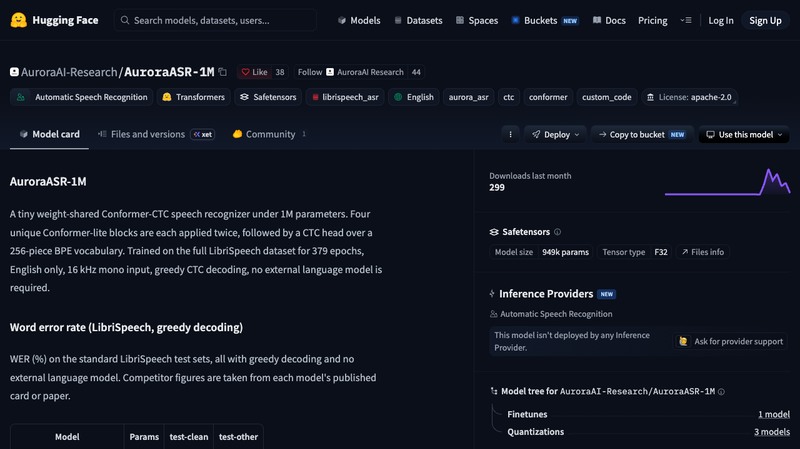
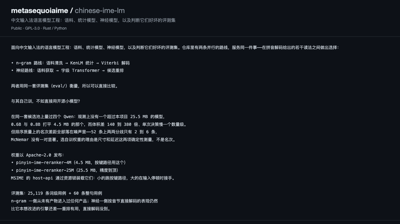
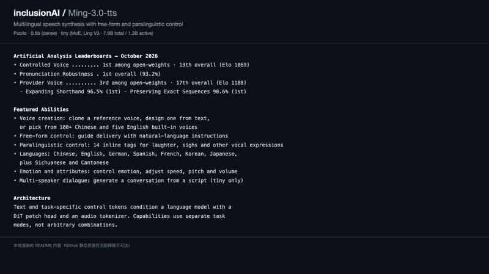
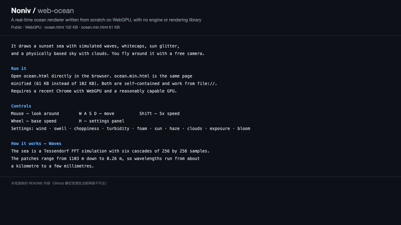
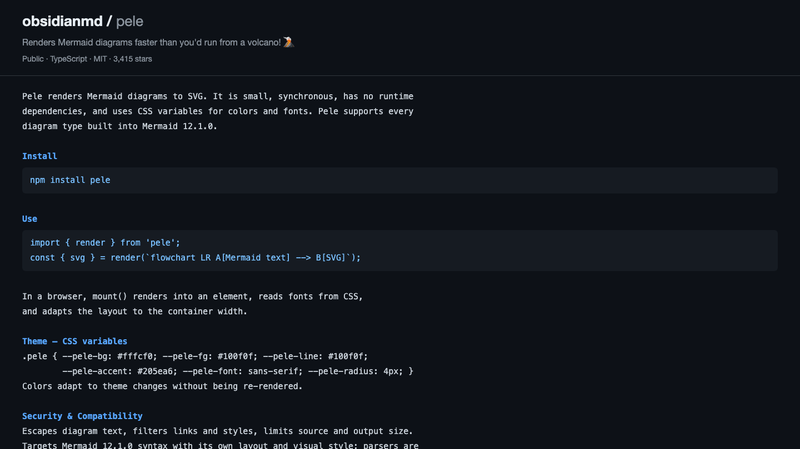
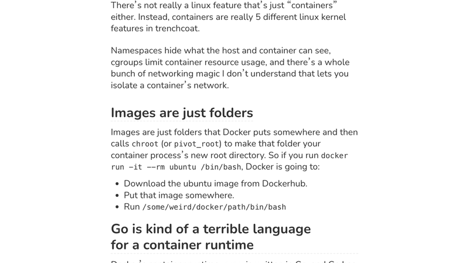
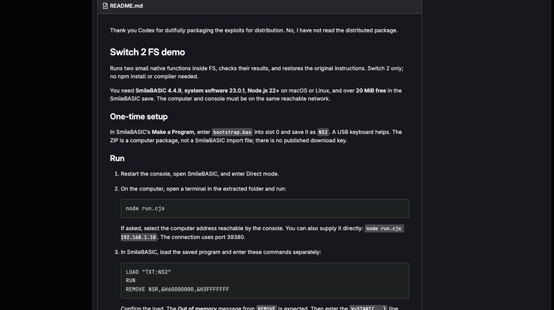
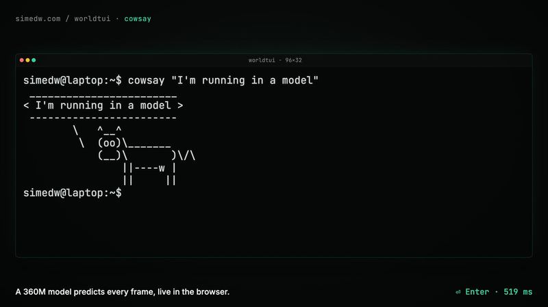

# 机器文摘 第 192 期

### Champagne：把 XNU 内核换掉，让 Cocoa 原样跑



[Champagne](https://github.com/unixzii/Champagne)，作者 Cyandev，88 Star，C++，**17,312 行**。目标：无需虚拟机，在 Windows（以及 macOS）上直接运行 **Mac OS X 10.6 Snow Leopard** 的原生应用。最惊人的是时间线——仓库创建于 2026-10-21，**28 个提交全部集中在 10-20 到 10-21 两天之内**。

它和 Wine 的根本区别，值得单独说清楚：**Wine 翻译 API，Champagne 提供内核**。

Champagne 只重写 **XNU 内核以下的部分**：Mach IPC、BSD 系统调用、虚拟内存、commpage、exec/Mach-O 加载、调度器和 trap gateway。**内核之上全部跑真实的 10.6.7 二进制，原封不动**——dyld、libSystem、Foundation、AppKit、CoreGraphics 都是苹果原版。

这意味着 **Cocoa / Objective-C 运行时根本不需要移植**：runtime 本来就在 10.6 的 libobjc/libSystem 里，`NSApplication`、AppKit 窗口、菜单、快捷键都是原版代码在跑，只是它们的系统调用落到了 Champagne 的内核实现上。相比之下 Wine 要重新实现 Win32 API 和大量 DLL——这是一条**更彻底也更省事**的路，代价是必须完整实现内核语义和 Mach IPC。

CPU 层目前用 **Unicorn（QEMU TCG）做 x86-64 全模拟**，并打了三个补丁（去掉每次访存的退出检查、unmapped 钩子不再走慢路径、自修改代码检查只限可执行页），让 `bc` 计算 π 的 1500 位从 16.3 秒降到 3.4 秒。设计上已经为**原生后端**铺好路：guest 内存归 VM 所有并通过 `translate()` 访问、线程状态直接用 Darwin 的 `x86_64_thread_state64`、trap gateway 和故障都抽象成事件、`src/host/reserve/` 预留了将来对齐固定地址空间的位置（可执行体 0x100000000、dyld 0x7FFF5FC00000、commpage）——这里才真正复刻了 Wine 的 preloader 思路。

两天内做到 TextEdit 逐像素复现，是一个技术密度极高的早期研究项目；生态覆盖目前还极窄，但方向很有意思。

### single-propeller-drone：一个电机怎么飞起来


[jyjblrd/single-propeller-drone](https://github.com/jyjblrd/single-propeller-drone)，511 Star。大部分小型穿越机都有四个螺旋桨，这个只有**一个电机、一个双叶桨**——而且不是靠推力矢量，是靠**机械式周期变距**。

机构是这样的：双叶桨通过 **45° 斜置铰链**接在桨毂上。电机**加速**时，桨叶因惯性滞后于桨毂，于是绕斜铰链转出一个迎角——一片迎角变大、另一片变小，两侧升力不对称，就产生了滚转或俯仰力矩；**减速**时反向。于是"姿态控制"变成了"对电机做加减速脉冲"。

方位控制更巧妙：把加减速脉冲**对准每转中的特定方位角**，合力矩的方向就跟着旋转——这在效果上等同于直升机的**周期变距（cyclic pitch）**，只不过没有斜盘、没有舵机，全部由软件在时间域实现。20,000 RPM 下，每秒要做 **300 次**加减速脉冲。

反扭矩靠机身 4 片 TPU 大鳍片被动抵消，代价是**偏航不可控**，机身会始终缓慢自转——作者用红外"灯塔"信标加光电传感器持续修正航向估计。

工程上的两个坑很有意思：普通无人机 ESC 用反电动势估转子位置，遇到每秒 300 次的扭矩跳变会失步，所以换成了 **moteus R4 伺服驱动器**（磁编码器 + FOC，位置直接测量不会丢同步）；又因为 300Hz 下让 MCU 中转会带来 2ms 延迟（约 20° 转角），作者干脆**改写了驱动器固件**，让飞控指令直达、力矩在驱动器板上计算，省掉一颗 MCU。飞控是 ArduPilot 的分支，调参用的是朴素的 P 控制器。

指标相当极端：6 英寸桨、20,000 RPM、**桨尖速度超过 500 km/h**（接近半音速），比 Pulsar 那类铰链桨无人机桨盘面积小 6 倍以上——作者称它是"飞行的铰链桨里最小最快的"。代价是：能起飞、能自稳、能响应摇杆，但只敢在卧室里飞，靠红外灯塔定位，偏航持续漂移，抗风差，也没法带载荷。调试过程也有趣：160Hz 振动让加速度计失效，作者自制"单帧频闪"高速摄影（驱动器发角度脉冲触发闪光灯），才发现桨叶在高速下会颤振弯曲，换更硬的桨叶才解决。

### AuroraASR-1M：949K 参数的语音识别



[AuroraASR-1M](https://huggingface.co/AuroraAI-Research/AuroraASR-1M)，Apache-2.0。**949,073 个参数**的语音识别模型，INT8 量化后 **1.06MB**，官方称在单 CPU 线程上可达约 436 倍实时速度。

怎么把参数压到这个量级？四个手段叠加：

1. **极窄宽度**：`d=128`、head_dim 只有 32、FFN 扩展比 3×（而非 4×），平方项直接砍到 1/16。
2. **权重共享**：4 个 Conformer-lite block 各跑 2 遍（等效深度 8），但每遍有独立 LayerNorm——只花 2048 个参数的代价，换深度翻倍，省下 48%。
3. **用 CTC 代替 Encoder-Decoder**：整个解码器被砍掉，输出层只剩 32,896 个参数。
4. **4× 卷积下采样**：mel 从 80 降到 20，序列长度变 1/4，注意力的 O(T²) 降到 1/16，而深度可分离卷积只占 144 个参数。

另有两个"零成本"设计：中间层辅助 CTC loss 复用 final_ln+head（0 参数），位置编码用 RoPE（无参数）。参数分配上 blocks 占 92.1%、stem 4.4%、head 3.5%。

训练数据只有 **LibriSpeech 960 小时**，没有外部数据、没有速度扰动、没有加噪（只有 SpecAugment），dropout=0，379 个 epoch 在单卡上跑了 10 小时；优化器用的是 **Muon（encoder 矩阵）+ AdamW（其余）** 的组合，这个选择比较新。准确率是 test-clean **11.43%** / test-other **26.50%**（贪心解码、无语言模型），INT8 几乎无损失——在 1M 参数以下算 SOTA 级，但和 10M 参数的 Citrinet-256 还差 3 倍，**不具备生产可用性**。

有两处需要修正流行说法：**FP16 反而更慢**（CPU 上慢 5.5 倍、GPU 上慢 1.3 倍，因为模型太小，类型转换和 launch 开销占了主导），实践应该用 FP32；**436 倍确实是真的但高度依赖硬件**，按 FLOPs 反算需要约 37 GFLOPS 单核，普通笔记本核显/CPU 大概落在 120–180 倍。另外"1.06MB"特指 INT8 版本，FP32 实际是 3.81MB。这个项目没有 GitHub 仓库、也没发布训练代码，但社区已经有 MLX、CoreML、ONNX+WebGPU 四个移植版本。

### chinese-ime-lm：输入法候选重排，以及一次诚实的对照实验



[chinese-ime-lm](https://github.com/metasequoiaime/chinese-ime-lm)，Metasequoia（水杉）的中文输入法语言模型工程：语料、统计模型、神经模型，加上一套判断它们好坏的评测集。它要解决的事很具体——**在拼音解码给出的若干读法之间做出选择**。

仓库里有两条并行路线，服务同一件事：一条是 **n-gram**（语料清洗 → KenLM → Viterbi 解码），一条是**神经模型**（字级 Transformer 做候选重排）。两条路线用**同一套评测集**衡量，所以可以正面比较。

但这份仓库最值得读的不是模型，而是**它的对照实验**。作者在同一套候选池上量了四个 Qwen 通用小模型，结论很直接：

> 观测上没有一个超过本项目 25.5MB 的模型，0.6B 与 0.8B 打平 4.5MB 的那个，而体积差 140 到 380 倍、单次决策慢一个数量级。

不过在排序**质量**上，名次差距全部落在噪声里——52 条上两两分歧只有 2 到 6 条，McNemar 检验没有一对显著，要检出 1–2 个百分点的差异需要一千到近万条用例。所以作者把话说得很清楚：**选自训权重的理由是尺寸和延迟这两项确定性测量，不是名次。** 这种"我知道我的数字能说明什么、不能说明什么"的诚实，在开源项目里不多见。

权重以 Apache-2.0 发布在 Hugging Face：`pinyin-ime-reranker-4M`（4.5MB，走按键路径）和 `pinyin-ime-reranker-25M`（25.5MB，精度到顶）。MSIME 的 host-api 通过资源锁装载它们——**小的跑按键路径，大的在输入停顿时接手**。评测集是 25,119 条词级用例加 60 条整句用例；同一次测量还发现整句集里有 12 条"他/她"在拼音上根本不可判，本就不该收。

作者也把失败讲明白了：n-gram 路线从未出过这个仓库；神经侧按音节**直接解码**仍然比它本想改进的引擎差——"**重排有用，直接解码没到**"。许可按目录区分：仓库整体 GPL-3.0，但 `reference/` 下的 Rust 推理实现单独以 Apache-2.0 授权、权重也是 Apache-2.0——理由是输入法生态大多是 MIT/Apache/BSD，链不了 GPL，"一个没人能采用的公共资源不成其为公共资源"。

### Ming-3.0-tts：0.5B 的多语言语音合成



[Ming-3.0-tts](https://github.com/inclusionAI/Ming-3.0-tts)，蚂蚁 inclusionAI 开源。提供两个语音生成模型：**0.5b**（dense，稠密）和 **tiny**（基于 Ling V3 的 MoE，总参数 7.9B、激活 1.3B）。

成绩在第三方榜单上很能打。Artificial Analysis 的 TTS 榜（2026 年 10 月）：**Controlled Voice 开源权重第 1**（总榜第 13，Elo 1069）、**Pronunciation Robustness 总榜第 1**（93.2%）、**Provider Voice 开源权重第 3**（总榜第 17，Elo 1188）。发音鲁棒性还可以再拆细：文本规范化（Expanding Shorthand）96.5% 第一、序列保真（Preserving Exact Sequences）90.6% 第一。

能力清单相当全：

- **声音创建**：克隆参考音色、用文本设计音色，或从 100+ 中文和 5 个英文内置音色里选。
- **自由形式控制**：用自然语言指令引导表达方式。
- **副语言控制**：14 个内联标签，可以插入笑声、叹气等发声。
- **语言与方言**：中、英、德、西、法、韩、日，加上四川话和粤语。
- **情绪与属性**：控制情绪，调整语速、音高、音量。
- **多说话人对话**：按脚本和说话人参考生成对话（仅 tiny 支持）。

架构上，文本和任务专属的控制 token 一起条件化一个语言模型，配 **DiT patch head** 和音频 tokenizer。需要说明的是：这些能力是**分开的任务模式，不能任意组合**——项目文档特意强调了这一点。在 0.5B 这个体量上，能同时做到开源权重第一档的发音鲁棒性和自然语言"捏音"，是这半年 TTS 领域进步速度的一个缩影。

### web-ocean：从零写的 WebGPU 海洋



[web-ocean](https://github.com/Noniv/web-ocean)，作者 Noniv，**不依赖 Three.js、Babylon.js 等任何 3D 引擎或渲染库**，在 WebGPU 上从零实现了一个实时海洋渲染器，画出日落海面：模拟波浪、白浪、太阳反光，以及带云的物理天空。

整个应用是**自包含的单文件**：`ocean.html` 102KB，压缩版 `ocean.min.html` 只有 **61KB**，从 `file://` 直接打开就能跑。需要较新的 Chrome 和够用的 GPU——笔记本上得在系统图形设置里强制 Chrome 用独显，否则会退到核显。

交互相当完整：鼠标看四周、WASD 移动、Shift 加速 5 倍、滚轮调基础速度，按 H 打开设置面板可以实时调**风、涌、碎浪、浑浊度、泡沫、太阳、雾霾、云、曝光、bloom**。相机自动保持在位移后的水面之上，所以波浪不会穿过镜头。还支持 URL 参数（`?w=2560&h=1440` 强制分辨率、`cam=x,y,z,yaw,pitch` 设相机、`fov=` 设视场角、`ui=0` 隐藏 HUD，以及任意设置项如 `windSpeed=12&swellHs=2&sunElev=8`）。

海浪用的是 **Tessendorf 的 FFT 方案，六个级联、每级 256×256 采样**：patch 尺寸从 1103 米一路覆盖到 0.26 米，也就是**波长跨度从约一公里到几毫米**。要在一个画面里同时表现大涌浪和细碎涟漪，级联是必须的——这也是为什么单靠一张法线贴图做不出可信的海面。作者的说明里提到这个项目是 Claude Code（Opus 5.5）辅助构建的，但代码本身是干净的从零实现：60KB 换一个能实时跑的海，性价比相当高。

### Pele：比 mermaid.js 快 100-500 倍的渲染库



[Pele](https://github.com/obsidianmd/pele)，3,415 Star，TypeScript。Obsidian 创始人做的新渲染库：把 **Mermaid 图渲染成 SVG**，小、同步、**没有运行时依赖**，颜色和字体全部走 CSS 变量。

它支持 **Mermaid 12.1.0 内建的每一类图表**。用法简单到只有几行：

```js
import { render } from 'pele'
const { svg } = render(`flowchart LR A[Mermaid text] --> B[SVG]`)
document.querySelector('#diagram').innerHTML = svg
```

在浏览器里用 `mount()` 更省事——它会渲染进元素、从 CSS 读取字体、并**按容器宽度自适应布局**。包体可以按需裁剪：用 `pele/core` 加单个图表类型注册（比如只 `import flowchart from 'pele/diagrams/flowchart'`），或者用 `pele/lazy` 的 `renderAsync` 异步加载。

主题机制是它设计上最舒服的一点：所有颜色和字体都是 CSS 变量（`--pele-bg`、`--pele-fg`、`--pele-line`、`--pele-accent`、`--pele-font`、`--pele-radius`，图表用 `--pele-series-1` 到 `--pele-series-8`），**切换主题不需要重新渲染**，因为颜色是 CSS 层的事。

安全和兼容性也考虑到了：渲染时转义图表文本、过滤链接和样式、限制源码与输出大小；解析器对着 Mermaid 的 parser 规范做测试，还用了**差分模糊测试**来对齐行为。它对标的正是 mermaid.js 那个"官方库但很难用"的处境——官方说法是比它**快 100 到 500 倍，打包体积小 6 倍**。Pele 会成为新版 Obsidian 的默认渲染器。

### Local Wikipedia：只显示你半小时步行范围内的维基百科


[Local Wikipedia](https://edjefferson.com/localwiki/)，作者 Ed Jefferson，HN 1551 分，副标题是"本地人的百科全书"（The Encyclopedia For Local People）。纯静态页面，没用框架，一个约 60KB 的 `script.js`。

核心规则只有一条：**只给你看步行半小时能走到的维基条目**。实现上最值得看的是它怎么定义"本地"：

- **概念半径 `RADIUS = 2414 米`**（1.5 英里）——这就是"半小时步行"的量化。
- **硬上限 `MAX_RADIUS = 10000 米`**（约 6 英里）——Wikipedia 的 `geosearch` 接口单片上限，一次最多 500 条。
- **规则**：先取 1.5 英里内的全部条目；**如果不足 25 条**（乡村地区很常见），就退化成"最近的 25 条"，半径随之被撑大（最远 6 英里）；超过 500 条则只取最近的 500 条。

实际效果很说明问题：格拉斯哥有 367 条（1.5 英里内）、皮特洛赫里正好 25 条（半径撑到 2.5 英里）、Lairg 只有 16 条（连 6 英里内都凑不满 25 条，页面就照实显示）——**同一套规则在城市和乡村给出完全不同的体验，而这种差异本身恰好是真实的**。

地点解析支持几种输入：`lat,lng` 坐标 → 英国邮编（走 postcodes.io）→ 邮编区 → 文本搜索（用 Photon，OSM 的搜索服务，取前 6 个候选按"城市/区/街道"排序）；非英国没有邮编就退回坐标。页面只显示 ward 或邮编前半段（比如 "Glasgow"、"W12"），不显示完整邮编——避免截图泄露精确位置。

数据全部来自 Wikipedia 官方 API，而且**只要带坐标的页面**：用 `list=geosearch&gscoord=lat|lng&gsradius=10000&gslimit=500` 一次拿回来，同时用 `generator=geosearch` 配合 `prop=info` 把每篇的字节长度也带回来。正文用 `action=parse` 直接注入 HTML，但会移除 `[edit]` 链接、维护模板、Kartographer 交互地图（它渲染不了），并剥离内部链接——只保留"也在附近"的条目可点。首页的"特色条目"按 30 天浏览量排序。距离用 haversine 自己重算（地球半径取 6371000），英制下小距离显示 yards、公制下显示米，可以切换。

### Permit Pending：模拟城市，但要办许可证


[Permit Pending](https://permit.petercai.com/)，作者 Peter Cai，Show HN 937 分。一句话：**经典模拟城市精神，但你不是神，你是民选市长。**

它的讽刺感写在首页：H1 是「BUILD THE CITY OF YOUR DREAMS.」，上面盖着一枚红色印章「**SUBJECT TO APPROVAL**」（须经审批）；一行小字「Free, because you are loved」（免费，因为你被爱着）；页脚更直接——「Permit Pending is not a joke. It is only a joke to you.」（这不是玩笑，只是对你而言是玩笑。）

玩法上的核心反转很彻底：**每一次开发都不是"建造"，而是"申请"**。每个项目走一条固定的案卷（docket）流水线，七个阶段清清楚楚：

> 申请（2 周）→ 市政人员审查（4 周）→ 市议会裁决（1 周）→ 上诉期（6 周）→ 审批生效（8 周）→ 施工（23 周）→ 竣工 / Certificate of Occupancy

实测一个 32 户四层公寓（Willow Bend）：2025-05-28 递交，**最早 2026-04-22 完工——将近 11 个月**。界面上还专门标注"Time at City Hall: 6 周受理 + 1 周听证"。

指标是一组相互冲突的量：市长支持率、财政、人口、失业率、**Clout（政治资本）**，以及红字的 **Permit 排队周数**；选举倒计时按 4 年一轮。

听证会 / Case 窗口相当于游戏的"战斗界面"：反对方状态可能显示 "Vocal（高声反对）"、支持方显示 "Quiet（沉默）"；公开异议写得非常真实——有人说「Neighborhood character」（"居民称设计不是我们想象的那样，但说不出他们想象的是什么"），也有人说「Affordable composition」（"住房倡导者说保障房比例是绑了蝴蝶结的舍入误差"）。议席预测给出 City Council forecast **2–5（需要 4 票）**，财政硬指标则是造价 620 万美元、Yield vs hurdle **9.1% / 5.5%**、市税每年 10.9 万美元。

它把"建城市"这个通常被浪漫化的题材，还原成了**土地利用政治学**：你真正在玩的不是画地图，而是排队、妥协、拉票、算账。

### Docker is weird：自己写一个容器运行时之后



[Docker is weird](https://codeandcake.dev/posts/2026-10-22-docker-is-weird)，HN 863 分。作者为了好玩自己动手写容器运行时，结果学到一堆"Docker 其实很怪"的事。这篇的价值正在于：**只有亲手实现一遍，才会发现那些概念模型有多松垮。**

第一个反常识：**容器不是真实存在的东西**。和虚拟机不同，容器只是"被施加了特殊限制的进程"——你的内核仍然在跑那个进程，只要知道去哪里找，甚至能在 `/proc` 里看到它。

第二个：**Linux 里也没有一个叫 "containers" 的特性**。容器其实是**五个内核特性穿一件风衣**：namespaces 决定谁能看到什么，cgroups 限制资源用量，还有一堆作者表示"我看不懂"的网络魔法负责隔离网络。

第三个：**镜像就是文件夹**。Docker 把镜像下载到某个地方，然后 `chroot`（或 `pivot_root`）让那个文件夹成为容器进程的新根目录。所以 `docker run -it --rm ubuntu /bin/bash` 的实际动作是：从 Docker Hub 下载 ubuntu 镜像 → 放到某个路径 → 执行 `/some/weird/docker/path/bin/bash`。

第四个最有意思：**Go 其实不太适合写容器运行时**。Docker 的 `runc` 是 Go 写的，而 Go 有几个设计让它别扭——Go 运行时原生多线程，但容器运行时需要的许多系统调用**必须在单线程环境里执行**，所以 `runc` 里塞了一个"C 模块"，在 Go 运行时初始化之前先跑那些 syscall。更麻烦的是 **Go 没有 fork**（fork 只 fork 主线程），而容器运行时恰恰需要"fork 之后设置一堆限制、再 exec 用户进程"这个动作——`runc` 的绕法是把 `/proc/self/exe` 带特殊命令行参数 exec 一次，**用一个子进程来模拟 fork**。

最后一条很多人不知道：**Docker 需要 root**。如果你像作者一样在 macOS 上跑 Docker，很容易忽略这件事——很多容器运行时用到的内核 API 需要 root 权限，所以 daemon 通常以 root 运行。现在的无根（rootless）方案看起来好多了，但大例外是网络：rootless 运行时如果要提供同样的功能，**几乎得在用户态把整个网络栈重新实现一遍**。

### Jailbreaking the Switch 2：两个 Agent 并行破解，两周拿下



[Jailbreaking the Switch 2](https://pepsipu.com/blog/2026-10-switch2-jailbreak-ns2jb/)，HN 827 分。作者发布了 **ns2jb**：针对 Switch 2 最新固件 **23.0.1** 的**纯软件、需连接电脑（tethered）的 jailbreak**，代码在 [gitlab.com/pepsipu/ns2jb](https://gitlab.com/pepsipu/ns2jb)。据他所知，这是 Switch 2 的第一个这类 exploit。

它能做到什么：**以任意普通 sysmodule 的身份、以及以内置 `fs` sysmodule 的身份运行任意原生代码**——于是可以跑 homebrew、逆向和 mod Switch 2 游戏、把存档备份出来、通过 MMIO 访问大部分外设。演示是让 Codex 一天之内 vibe-code 出了《马力欧赛车世界》的 mod（加了几个角色），而**jailbreak 本身花了大约两周**。

**硬件 harness 是这篇文章最妙的部分**：他们用两台 JetKVM 给 Switch 1 和 Switch 2 发手柄输入、从 HDMI 收视频输出——这样 Codex 就能自己操作主机。但还缺一件事：Switch 2 崩溃时需要按电源键重启。他们的解法是从亚马逊买了个**蓝牙"光开关"（light switch）**，杠杆压下时就按到电源键；按到底之后，剩余的扭矩会把机构抬起来。一个给智能家居用的开关，被用来给崩溃的游戏机按重启键。

技术路径有两条并行。**WebKit 路线**（主机破解的经典入口）：通过自定义 Wi-Fi captive portal 加载一个 n-day，用 `Math.expm1` 加 XHR 声称拿到了 "native control-flow hijack"。但要往下走很难——WebKit 有 **XOM（execute-only memory）**，即使拿到任意内存读写也不知道 gadget 在哪；就算找到了，**PAC**（指针认证）让伪造签名指针变得不确定；就算能签名，**CFI**（控制流完整性）还会对大多数调用点做类型检查。

**SmileBASIC 路线**（针对 Switch 1 游戏，因为 Switch 1 不支持 PAC、且 root of trust 已被攻破所以能解密代码）：Codex 在 BASIC 解释器里找到一个 **32 位整数溢出**。删除数组元素时的检查是 `position + count <= array.length`，但和会回绕成负数。执行 `REMOVE R,&H60000000,&H3FFFFFFF` 后，`position + count` 回绕成 `0x9fffffff`，作为有符号 32 位整数小于数组长度；乘以 8 也回绕，最终变成 `memmove(backing, backing - 8, 32)`——**把数组前面 8 个字节拉进了数组**。命令确实会报 "Out of memory"，但拷贝已经发生了。

而这 8 个字节恰好是**指向数组自身的指针**。于是 `R[0]` 被当成字符串处理时，指针占了长度字段的位置，字符串长度巨大，读写就越界了——通过复制 `R[0]` 的子串来任意读写内存。最终拿到了 ROP，屏幕上弹出 "HELLO FROM SWITCH 2"。

两条线并行推进：SmileBASIC agent 在 Switch 1 上干活，WebKit agent 在 Switch 2 上干活。这个工作方式本身就是新闻。

### WorldTUI：训练一个 360M 模型假装自己是终端



[WorldTUI](https://simedw.com/2026/10/21/world-model-terminal/)，作者 simedw，HN 640 分。一句话：**微调了一个 360M 参数的语言模型来当终端——背后没有 shell，也没有文件系统。** 每次按键进去，模型预测屏幕会变成什么样。

它能做的比想象中多：创建文件、跑 `vim` 和 `tmux`、玩 `snake`，而且**通常能记住几条命令之前你写下的内容**。浏览器里有个 208MB 的 demo，作者留了个巧妙的测试——在 prompt 里敲 `pythoon`（拼错），就能看到它并不是真的 shell。

动机来自世界模型：作者看到 Genie 3 之后开始想象"应用不是用代码写的，而是学出来的"——不是游戏引擎渲染画面，而是模型根据用户输入预测下一帧。但自己没有大 GPU 集群和视频数据，于是把野心缩小：**不做游戏世界，做终端**。

终端确实是个好选择，理由有三：它是**字符网格而不是像素**；可以靠运行真实 shell **无限生成完美标注的训练数据**；而且预训练语言模型本来就知道 `ls`、`cat` 应该输出什么。真正的问题是：**它能维持一个一致的世界，还是只是生成看起来像终端的文本？**

技术上最关键的判断是：**标准 LLM 逐 token 追加的方式不适合终端**。一个按键可以独立起作用（比如 vim 里的 `esc`），输出也不一定落在底部（`clear` 会清屏并把光标送回顶部）。所以它不预测文本流，而是**预测屏幕的变化**——把终端当成字符网格，一格一个字符。

会话开始时给一个快照：屏幕尺寸（尺寸是输入的一部分，不是固定 32×96）、内容和光标位置：

```
BOS SCREEN_START 32 96
ROW_0 0 'simedw@laptop:~$ '
CURSOR 0 17 1
SCREEN_END
```

之后每次按键以真实终端会发送的原始字节输入（字母就是字母、Enter 是 `\r`、Escape 是 `0x1b`、左箭头是 `ESC [ D`），模型回答"要重写哪些行、光标最后在哪"：

```
OUTPUT_START
ROW_0 17 'l'
CURSOR 0 18 1
OUTPUT_END
```

**它不清屏**，新字符直接覆盖旧的——这和真实终端的渲染方式一致。还有一个省事的设计：不需要新 token 来表示字符，因为 Qwen 本来就有全部 256 个字节值的 token，可以直接复用来表示字符、坐标和小数字。

模型基于 **Qwen2.5-Coder-0.5B**，训练数据是在 Docker 里运行真实程序录下来的终端会话。作者说两个最大的突破是**教它修复自己的错误**，以及**并行解码屏幕行**——后者对延迟至关重要，因为逐行串行生成会把交互体验拖垮。这个项目的意义不在于实用，而在于它提出了一个好问题：**当一个模型学会了"屏幕如何响应按键"，它到底学到了一个模拟器，还是一套关于终端的语法感？**

## 订阅
这里会不定期分享我看到的有趣的内容（不一定是最新的，但是有意思），因为大部分都与机器有关，所以先叫它"机器文摘"吧。

Github 仓库地址：https://github.com/sbabybird/MachineDigest

喜欢的朋友可以订阅关注：

- 通过微信公众号"从容地狂奔"订阅。


