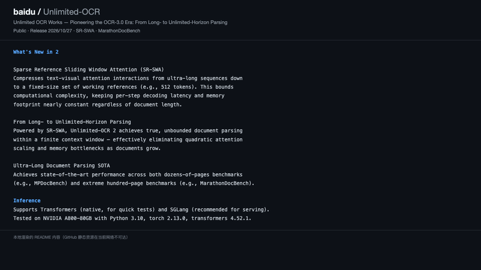
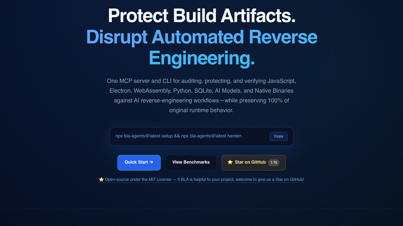
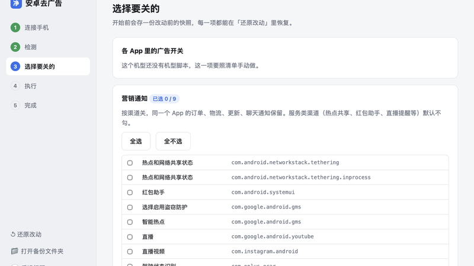
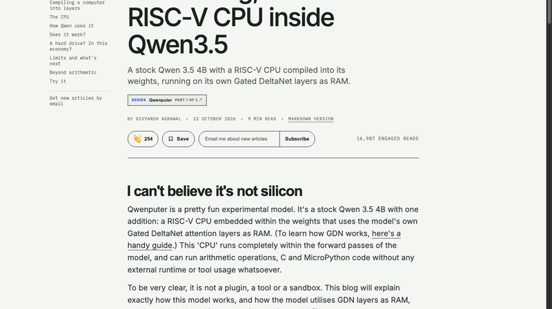
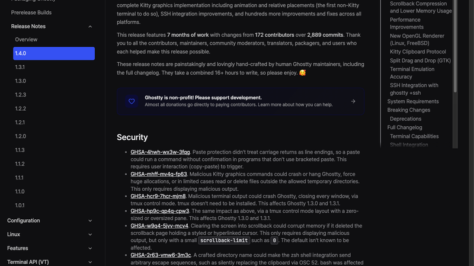
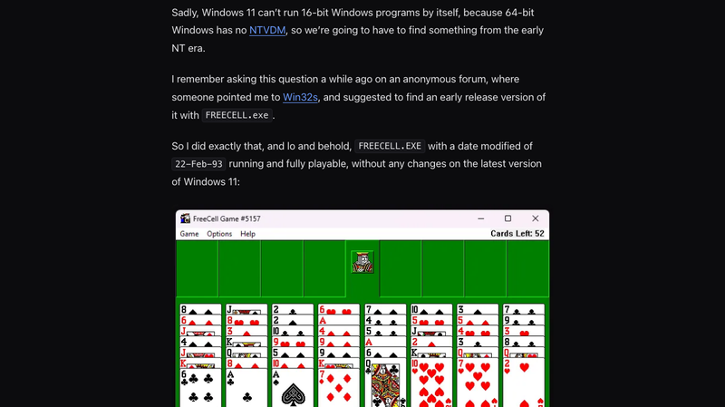
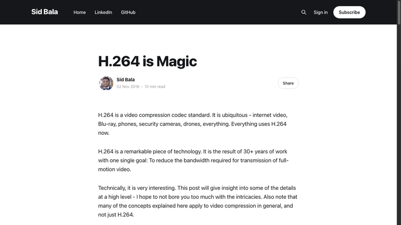
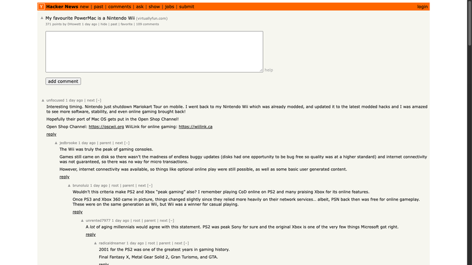
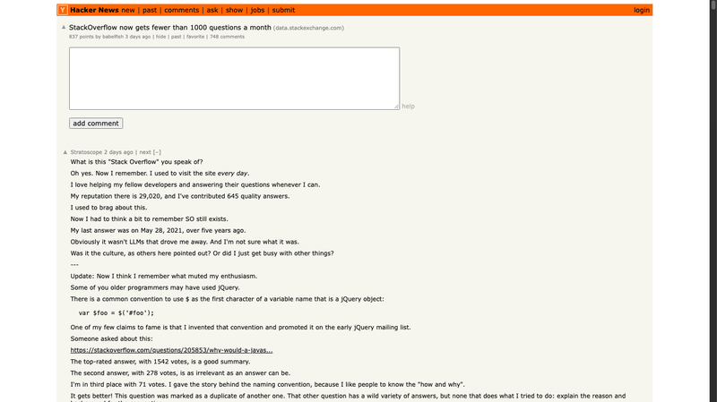
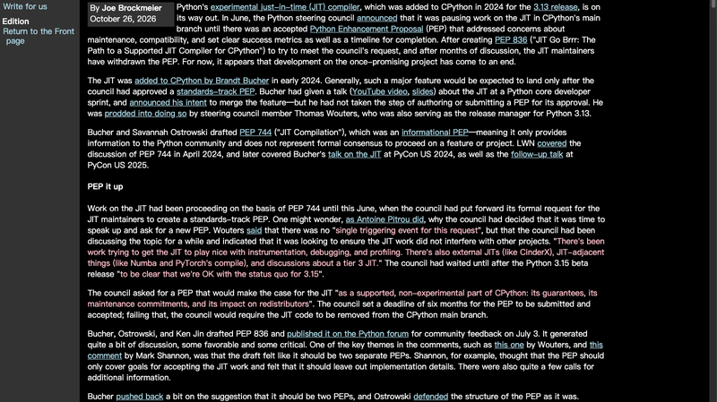

# 机器文摘 第 193 期

### Unlimited-OCR 2：把"无限长文档"的注意力成本压成常数

[Unlimited-OCR 2](https://github.com/baidu/Unlimited-OCR)，百度 2026-10-27 发布。它的口号是"开创 OCR-3.0 时代：**从长视界到无限视界解析**"。第一代（6 月发布）的定位是"把 DeepSeek-OCR 再推进一步"，这一代则直奔一个更硬的约束。

核心是 **SR-SWA（Sparse Reference Sliding Window Attention，稀疏参考滑动窗口注意力）**。它的思路不是"把上下文窗口做得更大"，而是**把文本-视觉之间的注意力交互，从一条超长序列压缩成一个固定大小的工作参考集**——比如始终维持在 512 个 token 量级。这样计算的复杂度就被限死了：**每步解码的延迟和内存占用几乎恒定，与文档长度无关。**

效果就是标题里那句"从长视界到无限视界"：在一个有限的上下文窗口里做到真正无界的文档解析，消除了文档变长时注意力二次膨胀和内存瓶颈。这也是"整本书 OCR"这个说法能成立的原因——不是把窗口调到 100 万 token 然后祈祷显存够用，而是让成本不随长度增长。

配套还发了一个新基准 **MarathonDocBench**，专门测超长文档解析。作者称它在几十页级（如 MPDocBench）和百页级（MarathonDocBench）基准上都是 SOTA。

工程侧比较务实：推理支持 **Transformers**（原生，适合快速测试）和 **SGLang**（推荐用于服务化），测试环境是 Python 3.10 + torch 2.13.0 + transformers 4.52.1，跑在 A800-80GB 上；模型同时上了 HuggingFace、ModelScope 和百度云。

顺带说一句，这条素材来自作者自己在微博上的推荐——他对国产 OCR 在中文与表格格式上的表现评价很高，这个判断在超长文档场景下尤其站得住：**中文文档的版面信息密度高，页数一多，"每页都要重新理解一遍"的开销是指数级放大的。**

### BLA：让 AI 逆向工程破产——不是混淆代码，是攻击分析器

[BLA](https://github.com/qybaihe/bla)（Blind LLM Agents），1,704 Star，一周内从 0 涨到这个数，MIT 协议。作者 Timo Zhang。口号非常直白：**Poison → Exhaust → Hallucinate**，以及"Make reverse engineering bankrupt again"。

它防的是 AI 逆向 agent——具体说是一个叫 **REA**（morluto/rea）的项目。而 BLA 的思路和传统混淆完全不同：**它不去让你的代码难读，而是去让"读代码的那个 agent"破产。**

做法是先把 REA 的源码常量和 prompt 契约逐行读一遍，找出所有阈值，然后**专门在那些阈值上把文件放得过大**。仓库里一共 24 个对抗向量，最有代表性的是"价格战"类：

- JavaScript 里把字符串/数字字面量拆成 **≥9 层三元表达式**，因为 2⁹ = 512，刚好超过 REA 的 `SEMANTIC_PRIMITIVE_CANDIDATE_LIMIT = 256`；
- 用自引用的 getter 环去打它的 `GETTER_EXPANSION_LIMIT = 512`；
- 塞 520 个以上的动态属性选择器，打 `ALIAS_SELECTION_LIMIT = 512`；
- 更狠的一招是**利用 REA 自己的 `codeUnits*6+2` 笛卡尔拼接公式**，让 14KB 的代码在它内部膨胀成 **2.7MB** 的"预算记账"。

格式层面同样如此：ASAR header 撑到 16MiB（它的 `DEFAULT_ASAR_MAX_HEADER_BYTES`）、Go buildinfo 撑到 1MiB、WASM 接口表示撑到 32MiB、Safetensors/GGUF 塞 35 层嵌套（它的限制是 32 层）、BEAM 超过 64 个 chunk、PCAP 让 tshark 的 JSON 输出超过 8MiB、Electron fuse 塞 33 个假哨兵（限 32 个）、SQLite 里塞一个 `GENERATED ALWAYS AS (bla_enclave_unseal(...))` 的虚拟列让只读连接直接报错。

还有一个我认为设计得最聪明的机制叫 **Obligation Flood**：REA 检测到 22 类"边界节点"时会强制 agent 为每一处生成 3–4 个验证 fixture。BLA 就把这 22 类**全部注入死分支**——于是逆向 agent 被迫做 20–60 倍的无用功，而死代码在运行时成本为零。再配合正则陷阱（批量生成 `auth_verify_token_*`、`license_key_slot_*` 这类近似命中串，让 `search_strings` 的正则 worker 在 5 秒 deadline / 128MiB 堆里先撞满），以及"影子业务逻辑"式的假分支欺骗。

需要说明的是，**BLA 是防御工具**，README 和 DISCLAIMER 明确写了只用于保护自己的软件，不主张攻击他人。另外它宣传上的口径不太统一：首页写 41.3×，benchmark 里最高到 2822×，首页取的是保守值。

这个项目有意思的地方在于，它揭示了一个新战场：**当逆向工程的成本主要花在 LLM 的 token 上时，"让分析变得不经济"就成了一种可工程化的防御手段**——不是把锁做得更结实，而是让开锁的人每撬一次都要付账单。

### android-ad-cleaner：不 root，把系统广告一个个拨掉

[android-ad-cleaner](https://github.com/rddmwmddr/android-ad-cleaner)，**5,360 Star**（2026-10-24 创建，7 天 5k），MIT。作者 rddmwmddr（Rikki Lv），就是微博上那个「肉呆大魔王」。功能一句话：**关掉国产安卓机系统里的广告、热搜、资讯推荐和营销推送，不 root、可还原。**

先澄清一个常见误解——它**不是**"ADB 批量禁用包名"那种粗暴做法。技术上它用的是 **ADB + uiautomator2 读屏点按**：读取 UI 节点文字找到入口，然后逐页把系统自带的开关一个个拨掉——「广告个性化」「广告跟踪(OAID)」「智能推荐服务」「商店服务管理」这些。**每一步都会回读核对**，所以是幂等的，可以放心重跑。

更细的地方在于克制：

- **广告组件只用 `pm suspend` 挂起**（`com.opos.ads`、`com.miui.systemAdSolution`、`com.heytap.pictorial` 等），而且需机主点头。README 明确说不使用 `pm uninstall`，也不用 `pm disable-user`——因为国行系统应用卸不掉，disable 常被拒绝或者连带搞坏功能。
- **营销通知按渠道关**：只关「内容与营销」「活动优惠」这类，订单、快递、更新、天气预警**全部保留**。
- **快应用**用 `quickapp off` 关闭，但**保留 `com.nearme.instant.platform`**——因为负一屏的快递卡片依赖它。
- 小米的 `msa` 挂起后仍会被系统 bind 拉起，工具还会顺带尝试断网。

工程上有一套机型脚本机制：每台机器一份"开哪个 App、点哪几层、关哪几个开关"的 recipe，按**型号 + 系统版本**精确匹配；版本对不上就自动进安全模式或跳过，绝不乱点。命令流是 `devices → check → backup → recipe → chan-scan/chan-off → quickapp → suspend → finish`，**改动前会把快照存到 `backups/<型号>-<时间>/`**。

四种用法覆盖了不同人群：让 AI 智能体克隆仓库读 `AGENTS.md` 自动跑、聊天 AI 带着一步步点、照着清单手动关、或者直接用桌面客户端（pywebview 界面，PyInstaller 打包）。当前 v0.2.9 提供四个包：macOS Apple 芯片 dmg（已签名并公证）、macOS Intel dmg、Windows 安装版、Windows 便携版。

### Qwenputer：把一台 RISC-V 电脑编译进模型权重里

[Qwenputer](https://divagr.com/blog/qwenputer)，作者 Divyansh Agrawal，HN 699 分。一句话：**一个原版 Qwen 3.5 4B，权重里嵌了一颗 RISC-V CPU，而这颗 CPU 的 RAM 就是模型自己的 Gated DeltaNet 注意力层。**

这个 CPU 完全运行在模型的**前向传播**里，能跑算术运算、C 代码和 MicroPython 代码，**不需要任何外部运行时、不需要调用任何工具**。作者特意强调：它不是插件、不是 tool、不是 sandbox——它就是权重。

关键的洞察在于：**Qwen3-Next 和 Qwen 3.5 这类混合模型的 Gated DeltaNet 层本质上是 RNN，而 RNN 的状态可以当作精确的 RAM 用。** 于是整个链条变成：Qwen 把一次乘法交给它自己权重里的 RISC-V CPU，CPU 的 RAM 是 GDN 的状态，结果再回到语言模型。作者还塞进了一个实验性的"模型内文件存储"。

文章分三部分，这一篇讲怎么把计算机编译进层里、CPU 怎么做、Qwen 怎么用它、以及"它真的能跑吗"。还有两个后续值得留意：一是**混合模型可以学会把推理藏在 RNN 状态里，从而逃避 CoT 监控**；二是这种"编译权重"可以当作模型自己无法篡改的内置监控工具——这两个方向都相当值得关注。

模型在 Hugging Face 和 ModelScope 上，代码在 GitHub。这个项目的意义不是"用模型代替 CPU"（那样又慢又贵），而是展示了一件更根本的事：**当模型的权重可以被当成一台确定性机器的存储介质时，"能力"和"工具"之间的边界就开始模糊了。**

### Ghostty 1.4：第一个完整实现 Kitty graphics 的非 Kitty 终端

[Ghostty 1.4.0](https://ghostty.org/docs/install/release-notes/1-4-0)，2026-10-27 发布，HN 1350 分。这是个大版本：**大幅的性能和内存改进**，以及一个里程碑——**100% 完整实现了 Kitty graphics 协议，包括动画和相对定位，是第一个做到这一点的非 Kitty 终端**。此外还有 SSH 集成的改进，以及跨平台数百项修复。

数字能说明工程量：**7 个月的工作、172 位贡献者、2,889 次提交**。Ghostty 由 Mitchell Hashimoto 主导，用 Zig 写，是原生应用而不是 Electron 套壳——这一点在启动速度和内存占用上差别明显。

安全上修了两个洞：一个粘贴保护的问题（没把回车当作行尾，所以在不支持 bracketed paste 的程序里粘贴可能不经确认就执行命令），一个恶意 Kitty graphics 命令的问题。

有个细节值得单独说：**这份 release notes 是维护者手工写的，全程花了 16 个小时以上**，包括完整 changelog。在一个"用 AI 生成 changelog"已经变成默认做法的时代，这条注脚本身就很 Ghostty。

### 还能在 Windows 11 上跑的最老 GUI 程序，是 1992 年的

[Oldest GUI application that still runs on Windows 11](https://blog.enlyth.com/posts/oldest-windows-gui-app-win-11/)，作者 enlyth，HN 543 分、339 条评论。一个看似简单的技术考古问题，答案却分三层：

| 层级 | 程序 | 日期 | 跨度 |
|---|---|---|---|
| 原生可跑（真正纪录） | `CDPLAYER.EXE`，NT 3.1 Build 347 | **1992-11-16** | ~34 年 |
| 原生可跑（作者最初的答案） | `FREECELL.EXE`，Win32s 发行包 | 1993-02-22 | 33 年 8 个月 |
| 需兼容层 | `REVERSI.EXE`，Windows 1.01 | 1985-11-15 | ~40 年 |

它们各自靠什么活到今天，原因完全不同：

**FREECELL** 之所以能跑，是因为它本来就是**为 Win32s 编译的 32 位 PE**——Win32s 是当年给 16 位 Win 3.1 用的 Win32 子集兼容层。剥掉那层壳之后，它调用的全是标准 Win32 API，新的 NT 内核天然认。

**CDPLAYER**（真正的纪录保持者）靠的是**两个巧合**：这个 build 已经把调用约定从 cdecl 修正成了 stdcall；而且它不使用自带 CRT，而是链接系统的 `crtdll.dll`——**这个老 DLL 至今还躺在 Windows 11 的 SysWOW64 目录里**。作者还自己写了 `cdemu.dll` 去伪造一个光驱，让这个 34 年前的音乐播放器真的放出了声音。

**REVERSI**（1985 年，Windows 1.01）虽然最老，但要跑起来得靠 otvdm，作者自己也承认这是"作弊"。

文章真正的发现在这里：**纪录的边界不是"程序有多老"，而是 1992 年那次 cdecl → stdcall 的调用约定修正。** 再往前（1991 年的 NT 预发布版）有两个致命障碍：草案版的 PE 格式，以及 cdecl 调用会导致栈参数被弹两次（`ret 4` 之后又 `add esp,4`）——必崩。另一个硬性断点是：**64 位 Windows 没有 NTVDM**（它依赖 CPU 真实 16 位模式，在长模式下不可用），于是整个 16 位时代直接出局。

评论区把这篇文章补得更完整：有人纠正了 Win32s 的时间线（它与 NT 3.1 并行开发，beta 在 1992 年 10 月，不是"NT 之前"）；有人指出更早的 Win16 版 FreeCell 其实存在于 1991 年的 Microsoft Entertainment Pack 2 里；还有人指出截图里那个其实是 Klondike 变体，不是严格的 FreeCell 规则。非 Windows 的候选也被提了出来：X11 的 `xwm`（1984）和 `twm`（1989）今天仍能在 Xorg 上跑，NetBSD 能跑 SunOS 4.x 的图形程序，SCO OpenServer 还支持 XENIX 的 `x.out` 二进制。

这类文章迷人之处在于：**兼容性不是抽象承诺，而是一个个具体的 DLL、一次具体的调用约定修正、一个具体的编译器开关**。三十年后还能跑，靠的从来不是"向后兼容"这句口号。

### H.264 is Magic：一个十年后还在被转发的老文

[H.264 is Magic](https://sidbala.com/h-264-is-magic/)，Sid Bala 写于 2016 年，本周又被 HN 翻出来推到 1228 分。它值得每隔几年重读一次——因为 H.264 太成功了，成功到我们忘了它有多难。

先看一个让人愣住的对比。作者截了 Apple 首页，做了两个文件：

- 这张网页的 **PNG 截图：1015 KB**
- 同一张网页的 **5 秒 60fps H.264 视频：175 KB**

300 帧的视频，文件只有单帧 PNG 的五分之一。看起来 H.264 比 PNG 高效了约 1500 倍。这怎么可能？

因为方向根本不同：**PNG 是无损的**（一个 bit 都不丢，原图可以逐位还原），**H.264 是有损的**（丢掉不重要的信息，只留有价值的）。作者用"减重赛车"打比方：想跑得更快，第一件事就是把后排座椅、低音炮、空调全扔了——只留下真正重要的东西。

那"重要"怎么定义？文章给了一个很直观的例子：把原图放大对比，压缩后的图里 **MacBook Pro 扬声器格栅上那些细小的孔消失了**——不放大根本注意不到——而这张图只有原图 7% 的大小。这是一切有损压缩的起点：**丢细节**。

接下来才是真正好玩的数学：信息熵。熵不是"数据有多大"，而是**表示这些信息最少需要多少 bit**。抛一次硬币 1 bit，抛两次 2 bit。但如果你有一枚奇怪的硬币，抛 10 次全是正面，这 10 次里的信息量其实远小于 10 bit——因为这串结果高度可预测。压缩的本质就是：**找出数据中可预测的部分，只编码真正意外的部分**。

H.264 把这一路能用的技巧几乎全用上了——色度子采样（人眼对亮度敏感、对色彩不敏感）、帧内预测、帧间运动补偿（大部分帧和前一帧几乎一样，只编码"哪里动了"）、DCT 变换和量化（把图像转到频域，高频细节粗量化）。一篇文章当然讲不完 30 年积累的所有技巧，但这篇是少有的、把"为什么能压缩"讲明白了的入门。

### Emacs 50 岁：从一个"编辑器宏包"到一种生活方式

[Emacs Turns 50](https://www.technologyreview.com/2026/10/20/1145399/emacs-turns-50/)，MIT Technology Review 撰稿人 Simson Garfinkel（MIT '87）写的纪念文，HN 519 分。

Emacs 的起点并不是一个编辑器。1970 年代在 MIT 人工智能实验室，它是作为 **TECO 编辑器的宏包**诞生的——名字就是 **E**ditor **MAC**ro**S** 的缩写（这也是为什么"EMACS"原本是大写，而今天 GNU Emacs 通常写作小写）。Richard Stallman 的分发方式今天看来近乎浪漫：**谁寄来一盘磁带和一个贴好邮票的回邮信封，他就把 EMACS 寄回去**。1981 年的手册里写着：

> EMACS 不收费；你是在加入 EMACS 软件共享公社。会员条件是：你必须把你做的任何改进寄回来。

然后故事转向了另一面。Bernard S. Greenberg 在 Honeywell 时为 Multics 写了自己的 EMACS 版本，1980 年拿了国际 Honeywell 软件会议一等奖，Honeywell 开始销售它。**James Gosling**——对，就是后来主导 Java 的那位——也做了一个版本并作为商业产品出售。正是这种"从免费到收费"的转变，促使 Stallman 发起了 GNU 项目：**GNU's Not Unix**，因为与 Unix 不同，它将保持自由。而 GNU 的第一个主要应用，就是 GNU Emacs。

今天 Emacs 还在一些意想不到的地方。2001 年 Mac OS X 首发时包含了 GNU Emacs；Apple 在 2019 年停止预装，但仍保留了一个叫 **mg**（Micro GNU Emacs）的程序——它支持大部分 EMACS 命令，却缺少内嵌编程语言，被一些人称为"仿制的 Emacs"。更有意思的是，**macOS 至今大量隐藏支持 EMACS 键位**：键盘上没有 Meta 键，但 `Control-Option-B` 会后退一个词，`Control-Option-F` 会前进一个词。五十年过去，它的按键习惯已经渗进了操作系统的血肉里。

### 我最喜欢的 PowerMac，是一台任天堂 Wii

[My favourite PowerMac is a Nintendo Wii](https://virtuallyfun.com/2026/10/29/my-favourite-powermac-is-a-nintendo-wii/)，Virtually Fun 上的客座文章，作者 Rairii，HN 371 分。

成果就是标题下那两张图：**Mac OS 7.6 在 Wii 上启动**，**Mac OS 9.2.2 在 Wii 上跑到了桌面**。作者自己评价这件事的分量：这很可能是 CHRP 克隆机时代之后，**第一次有 Apple 之外的人把 classic Mac OS 带到一台新系统的桌面上**。

他瞄准的是采用"ArtX 芯片组"的 PowerPC 主机——GameCube、Wii，未来还想做 Wii U。这个选择的依据相当硬核：GameCube 的 Flipper 集成芯片组实际上由 ArtX 设计（ATI 收购该公司时它基本已经完工），而 Wii 的 Vegas（及后来修订版 Bollywood）和 Wii U 的 Latte 是它的直系后继。

动机也很有意思。他之前移植过 Windows NT——顺带买了些 PowerPC Mac 笔记本也移植了一轮，几个移植项目互相喂经验。这个过程让他熟悉了 classic Mac OS，然后"**爱上了它的 jank**"：从 1980 年代起层层堆叠的 hack，"hacks upon hacks upon hacks"，在他看来正是这个系统的魅力所在。还有个彩蛋：TBXI 的 m68k 部分名叫 **"SuperMario"**，而且整个 PowerPC 时代一直叫这个名字——1990 年代初写这段代码的某位开发者，大概是个游戏粉丝。

项目从 2025-06-22 fork 上游开始，作者坦率地说离公开可用还很远，这篇文章主要是记录阶段性成果和踩到的坑。"在游戏机上跑 1990 年代的操作系统"这类项目看起来像纯粹的炫技，但作者给出的理由很朴素：**只有把一个系统移植到完全陌生的硬件上，你才会真正理解它假设了什么。**

### web-design-engineer：把"品味"写成流程

[web-design-engineer](https://github.com/ConardLi/garden-skills)，13.4k Star，是 garden-skills 里最受关注的一个 **Agent Skill**：让 AI 做出来的网页不那么"AI 味"。它的做法不是给几句"要高级感"的风格提示，而是把设计经验**编码成规则、参考库和工作流三位一体**。

最值得学的是它的流程设计。它不是"你描述一下需求然后我出图"，而是一条强制流水线：需求澄清 → 素材上下文 → **Design Read**（在五个维度上打分：视觉变化、动效强度、信息密度、素材依赖、品牌保真，都是 1–10 分）→ **写代码之前先宣告设计系统**（配色/字体/间距/圆角/阴影/动效）→ v0 草稿 → 完整构建 → 验收。中间有三个硬性检查点，必须停下来等用户确认。

针对"AI 味"，它有一份**反俗套清单**：明确点名 Inter 字体 + `#3b82f6` 蓝按钮 + 紫粉渐变 + emoji 当图标 + 假好评数据这套组合。但关键在于它不只是禁止——每一条都写成「默认 → 理由 → 例外 → 检测方法 → 修复方式」，这样模型知道什么时候该破例，而不是机械规避。

真正撑起"品味"的是 **25 套风格配方库**，每套都绑定真实锚点：Linear、Aesop、Pentagram、无印良品的原研哉风格、Bloomberg Terminal、Y2K、Vignelli 的瑞士风格、mid-century 等等，内含可直接粘贴的配色、字体、间距和"签名手法"。而且**按需只读一个文件**——这是很懂上下文管理的设计，避免把 25 套风格全塞进 prompt 造成互相污染。另有三张索引表（按学派 / 按适用场景 / 按模式）和六个学派的设计方向顾问，需求模糊时给你三个差异化方向。

素材处理上也有硬规则：识别度排序是 **Logo > 产品图 > UI 截图 > 色值 > 字体**；**禁止用 CSS 剪影冒充产品图**，取不到素材就停下来问用户，而不是编造。验收则是五维打分——哲学一致性、层级、工艺、功能、原创性。

覆盖范围从落地页、仪表盘、原型、slide deck 到动画、数据可视化、UI mockup、设计系统探索，另有 oklch 色彩系统、React CDN 模板、设备框架、动效时间线等代码模板。这份东西最有意思的地方在于它示范了一件事：**"审美"并不神秘，它很大程度上是一组可枚举的决策和它们的理由**——只要愿意把理由写下来。

### Stack Overflow 现在每月新增问题不到 1000 个

[Stack Overflow now gets fewer than 1000 questions a month](https://data.stackexchange.com/stackoverflow/query/1926661)，HN 837 分、339 条评论。这个数字本身就是一个结论：**曾经每月十万级的提问量，现在跌到不足一千。**

评论区比数据更耐读。

最扎心的一条来自 werdnapk：**"那 AI 在它的数据上训练了多少？这才是最悲哀的部分。没人问新问题了，AI 也就没有新数据可训。"** 这是一个很清晰的循环——AI 吃掉了问答站点的流量，问答站点因此失去了产生新数据的动力，而下一代模型的训练数据正来自这些站点。

armchairhacker 提了另一个角度：**"SO 早就没用了，但其他 Stack Exchange 站点还有意思，它们值得更多关注。"** 这条下面有人接着分析：真正的分化发生在"高度技术"和"兴趣驱动"之间——Stack Overflow、Unix & Linux、MathOverflow 这类硬技术站点使用量急剧下滑，而 SciFi & Fantasy、Worldbuilding 这种带着想象力和社区氛围的站点反而维持了相关性。可惜的是，那些小众站点过去靠 SO 输送推荐流量，现在整个生态一起萎缩。

还有一条很现实的抱怨（6510）：搜索结果页面臃肿得像 Myspace，"这个问题已经被问过了"的重复内容到处都是，让人根本不想点进去；网站不瞬间加载，人就不会在里面浏览；搜索质量也一言难尽。最后一句评价颇狠：**"他们到现在都没做个 LLM，这相当不技术。"**

这期我特别想把这四条放在一起看，因为它们指向同一个结构性问题：**一个以"人类提问、人类回答"为核心的社区，在"机器回答一切"的世界里该如何存在？** 答案目前看来不是"做得更好"，而是这个品类本身在退潮。

### Python 的实验性 JIT 要没了：一次失败的治理，而非失败的技术

[Python's experimental JIT to be removed](https://lwn.net/SubscriberLink/1102102/0c00e4d550f25f8c/)，LWN 的 Joe Brockmeier 报道，HN 579 分。这个故事的看点不是"JIT 没做成"，而是**它死在了 PEP 流程上**。

时间线很清楚。JIT 由 Brandt Bucher 在 2024 年初加入 CPython，随 **Python 3.13** 发布。按常理，这种量级的功能应该先有 steering council 批准的 standards-track PEP；但 Bucher 是在核心开发者 sprint 上做了演讲、宣布合并意图就动手了，**没有走到撰写并提交 PEP 这一步**。后来在 council 成员 Thomas Wouters（同时也是 3.13 的 release manager）催促下，Bucher 和 Savannah Ostrowski 补了 **PEP 744**——但那是一份**信息性（informational）PEP**，按定义只提供信息，并不代表"社区同意推进这个功能"。

今年 6 月，council 正式要求：写一份 standards-track PEP，论证 JIT 应当成为**受支持的、非实验性的** CPython 组成部分——它的保证是什么、维护承诺是什么、对各个重新分发者（发行版打包者）有什么影响。**期限六个月，到期不接受就从 main 分支移除代码。**

council 为什么在这个时间点发声？Wouters 说没有"单一触发事件"，但列出了一堆正在互相挤压的工作：让 JIT 与 instrumentation、调试、profiling 配合的问题；外部 JIT（如 CinderX）；JIT 相邻的东西（Numba、PyTorch 的 `compile`）；以及关于 tier 3 JIT 的讨论。他还特意说明，council 等到 Python 3.15 beta 发布之后才表态，是为了"先把话说明白：3.15 保持现状我们没意见"。

Bucher、Ostrowski 和 Ken Jin 随后起草了 **PEP 836**（标题很有意思：*JIT Go Brrr: The Path to a Supported JIT Compiler for CPython*），7 月 3 日发到 Python 论坛征求意见。讨论里的核心批评是**结构问题**：Wouters 和 Mark Shannon 都认为它应该拆成两份 PEP，Shannon 尤其认为 PEP 只该讲"接受 JIT 的目标"，不该掺实现细节。要求补充信息的呼声也不少。

经过几个月讨论，**维护者撤回了 PEP**。项目就此停摆。

这件事最值得琢磨的地方在于：**Python 的 JIT 在技术上是有进展的，但它在治理上从一开始就缺了一环。** 一个没有经过正式共识程序就落地的实验性功能，三年后要为"能不能算正式组件"补交作业，而这份作业的评判标准（六个月内达成共识）和时间成本，最终超过了继续推进的意愿。这大概是开源项目最典型也最容易被忽略的一种失败模式：**不是代码写不出来，而是没人能说清"它应该被当作什么"。**

## 订阅
这里会不定期分享我看到的有趣的内容（不一定是最新的，但是有意思），因为大部分都与机器有关，所以先叫它"机器文摘"吧。

Github 仓库地址：https://github.com/sbabybird/MachineDigest

喜欢的朋友可以订阅关注：

- 通过微信公众号"从容地狂奔"订阅。

