# 机器文摘 第 195 期

### Switch 的机器码，直接跑在苹果芯片上

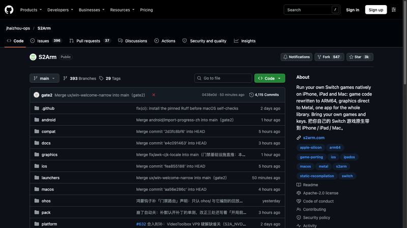

[S2Arm](https://github.com/jhaizhou-ops/S2Arm)，3,012 星，仓库建于 11 月 8 日——不到十天涨到 3k。它做的事一句话能说完：把 Switch 游戏的 ARM64 机器码**在构建时**重写成原生代码，然后直接跑在 iPhone、iPad 和 Mac 上。

关键在于它不叫模拟器，也确实不是。Switch 的 Tegra X1 和苹果 A/M 系芯片同属 ARM64，指令集同源，所以 S2Arm 走的是 **AOT 静态重编译**——你在界面上点 Build，它把游戏的 NSO 可执行段整体变换成 iOS/macOS 能直接加载的原生产物，运行时中间**没有 CPU 模拟器**。这和 Yuzu、Ryujinx 那类 JIT 路线是两回事：后者每帧都在逐条翻译指令，S2Arm 在构建完成之后就把翻译开销永久消掉了。图形层同样不走"模拟 Maxwell GPU 再翻译 shader"的活，NVN 调用直接转成 **Metal**，shader 构建期预处理（一个开放世界游戏统计出 26,999 个 shader）。

系统服务层它没有硬扛，README 老实写着上游是 **Ryujinx**——文件系统、输入、音频、账户这些兼容胶水沿用了这个 MIT 项目的成果。所以准确说法是 CPU 不模拟、GPU 不模拟，只有兼容层站在前人肩上。

代价也摆在明面上：每个游戏要编译一次。16GB M3 MacBook Air 上，一个 23.5 GB 的动作 RPG 花 6.4 分钟，一个 12 GB 的生活模拟花 8.6 分钟，那个 26,999 个 shader 的开放世界要 **34 分钟**。换来的是一台 iPhone 17 Pro Max 冷机跑满 60 fps，持续负载升温后 37–43 fps，能效约 **0.15 J/帧**——这是"低发热长续航"说法的量化依据。规模上它调研了 211 款游戏，首次构建成功率 95%，真机测试 iOS 4,700 多次。

边界写得比多数同类项目诚实：只支持 64 位 AArch64（苹果芯片跑不了 32 位 ARM），需要 36 位地址空间的游戏也不行。法律上则是标准灰区——仓库不提供游戏和密钥，用户自备本体和自己的 keys，用自己的 Apple ID 签名安装，整个游戏库共用一个 App 位置。

我觉得这个项目真正值得记的不是"又一个 Switch 模拟器上线了"，而是它验证了**把运行时翻译税挪成构建时一次性成本**这条路线在消费级设备上成立。60 fps、0.15 J/帧、95% 成功率，这已经不是概念验证了。

### 用 Rust + GPUI 重写了 Windows 任务管理器

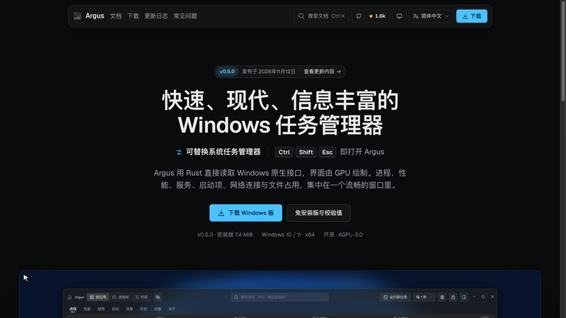

[Argus](https://github.com/Ray-lea/Argus)，1,607 星，仓库 10 月 12 日建的，一个月做到这个数，官网下载计数 9,795 次，881 个提交。国内个人开发者 Ray-lea 一个人推的节奏。

先纠正一个流传挺广的说法：它不是 Tauri 2 + SolidJS。README 写得很明确——**Rust 直接调 Windows 原生接口，界面基于 GPUI Kit 原生组件**，也就是 Zed 编辑器那套 UI 框架。仓库里确实要 Node/pnpm，但那只是打包和资源管线（Biome 检查、NSIS 做安装包），界面本身**没有 WebView**。这个区别是它性能故事的全部前提。

它和自带 taskmgr.exe 的差别逐条能对上痛点。进程页支持应用/进程树/列表三种视图，能结束整棵进程树；性能页把 P 核和 E 核分开看，带频率、温度和功耗，内存磁盘网络 GPU 全量；**历史数据给足 7 天**，而且单击曲线上任意时刻能回看当时最忙的是哪个进程——这是最有杀伤力的一个功能，自带任务管理器只有 60 秒滚动图。网络页能按端口查连接及所属进程并直接断开。文件被占用查不到？把文件或文件夹直接拖进窗口，它列出占着它的进程。还能接管 `Ctrl+Shift+Esc` 替换系统任务管理器，托盘常驻，`Ctrl+Alt+Esc` 全局唤出。

温度功耗这类传感器数据需要内核级访问，它走 **PawnIO 签名驱动**按需下载，装不上就降级，不影响主功能。安装包 74 MB，另有免安装单文件版，界面是 Mica 材质跟着系统强调色走，八种语言。

我觉得这个项目最值得看的是选型勇气。GPUI 生态在 Windows 上还很小众，敢用它意味着窗口、表格、曲线这些组件得自己啃一遍（所以有了 GPUI Kit）。但一旦做成，后来者拿 Tauri 复刻在性能上追不上——"曲线随屏幕刷新率连续流动 + 后台常驻低开销"是 WebView 方案的结构性劣势。风险也清楚：AGPL-3.0 挡住商业复用，单人维护的 bus factor，还有传感器覆盖的长尾硬件。

### Agent 写的是 MIDI，不是音频

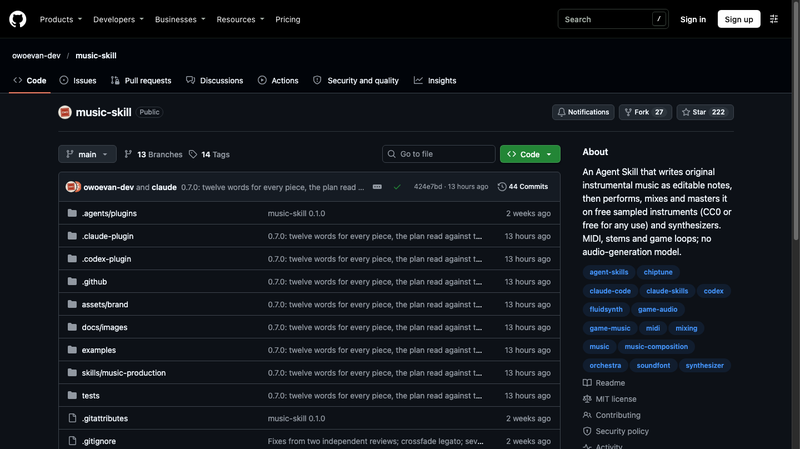

[music-skill](https://github.com/owoevan-dev/music-skill)，222 星，MIT。它的 README 开头就一句口号：**"Don't generate it. Compose it."** 在所有人把音乐交给扩散模型的 2026 年，这个项目让 agent 回到写符号——逐个音符写谱，再用采样器演奏出来。

流程设计得很像真正的作曲课。每首曲子开始随机抽 **12 个词**，agent 把"你的需求 + 这 12 个词"编成一个场景，由场景决定你没指定的部分。作者的理由很实在：让同一个 prompt 两次产出不像同一个东西，对抗大模型的均值塌缩。然后写 plan（高潮在哪、用什么手段到达），再写 project file——音高时长进 score 层，怎么演奏（力度、时值、释放）单独进 performance 层，谱面和演绎分离，等价于 MIDI note 与 DAW groove 的经典分工。

最硬核的一步是 `review`。它先统计出三张表（每段有哪些声部在响、和弦变化频率、旋律节奏），然后拿谱子对着 plan 审：列出声部间持续的小二度和小九度撞音，把每个和弦外音归类成经过音/挂留音/其他装饰音并追问没被级进解决的那些，列出平行五度、平行八度和低音区过近的音程。**每个问题都有编号，agent 必须写下以编号开头的决定来回答**——于是每个可疑点要么变成有意的选择，要么被改掉，不能是手滑。这是把和声学和对位法检查器做成了 agent 的 lint，整个音乐 AI 圈几乎没人干这件事。

产物才见真章：不是一段音频，是 MP3 + WAV + **MIDI** + 每个声部一条 stem + 各条 bus 与 reverb return + 能重渲染的工程文件。改一个音符，只重新合成那一个声部，没变的直接读缓存（等价于 DAW 的 freeze track），但每次都会重混所有分轨，让共享的 reverb 尾巴跟着更新。响度目标默认 −16 LUFS，true peak ≤ −1 dBTP。给游戏用的场景更狠：把 reverb 尾巴折回 loop 起点，loop 点写进 WAV 和 Ogg（Godot、RPG Maker 认的格式），还能把 loop 分层随战斗强度叠加。

它和 Suno 那类工具的根本分野在这：那些解决"我要一段听起来像 X 的音乐"，这个解决"我要一段能嵌进我的作品、还能改的音乐"。前者是内容消费，后者是生产工具。

局限作者自己列得很坦诚：不唱歌不写歌词、只支持 Surge XT 插件、音质上限就是免费音色库的上限（弦乐组起音慢、吉他滑音是整段移调）、没有东亚乐器。最诚实的一条是**agent 听不见**——`review` 和 `analyze` 只能定位问题，最终必须人来听，skill 里明确要求 agent 不许声称自己听过。

### C++17 手写 LLM 推理引擎

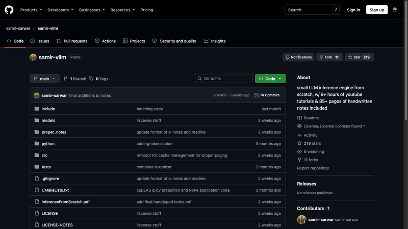

[samir-vllm](https://github.com/samir-sarwar/samir-vllm)，219 星。作者 Samir Sarwar 的定位很明确："Teaching LLM inference from first principles by building a small engine in C++ and CUDA." 不是要替代 vLLM，是造一个 vLLM 的教学级缩微版。

他真的一层层写下来了。权重直接读 `model.safetensors`（解析 metadata、校验 tensor offset、把 BF16 原始权重拷上 GPU，另有 mmap 版本省掉一次 CPU 拷贝）；Tokenizer 是自己写的本地 BPE，链 ICU 处理 Unicode；算子全是手写 CUDA——embedding-gather、RMSNorm、RoPE、paged decode attention（FP32 online softmax），只有矩阵乘交给 cuBLAS。解码器 16 层全通：Q/K/V 投影、RoPE、GQA、SwiGLU MLP、残差、最后的 RMSNorm 加 tied embedding 出 logits。

真正值钱的是它把 vLLM 那套机制缩到了能读完的规模：共享 BF16 KV page pool，一个物理 page 存 16 个 token 的 K 和 V，每个 sequence 每层一张 block table，这就是 PagedAttention 的实体；continuous batching 按 page budget 准入排队，请求完成归还 page 和预算。

有意思的是作者明确放弃了抢占。vLLM 的 preemption 和 recomputation 他没做，改用保守准入——在跑的请求一定保证跑完，绝不因为 page 边界增长而耗尽池子或死锁。他的话很实在：宁可限制并发，也不引入这套复杂度。代价是请求的输出预算开太大就会限制并发，哪怕模型其实提前停了。

配套材料才是它 219 星还天天被转的原因：**11 个视频、6 小时以上录像、85 页手写讲义**，从 Part 0「AI inference explained」到 Finale「Paged attention」，一集一个模块。作者强调手写讲义 "NO AI writing"，全部自己敲的；同时也老实交代 `proper_notes/` 那套教科书风格的 Markdown 和 PDF 是 AI 基于他的视频和笔记生成的。许可证还是分裂的——代码 MIT，笔记和 PDF 全部 all rights reserved。

它没有性能数字，一个都没有。作者在 `proper_notes/README.md` 里写得很清楚：这是学习引擎，数值对比和性能测量需要匹配的 checkpoint、tokenizer 和合适的卡，笔记描述的是验证步骤而不是宣称跑过。所以想拿它跑生产请直接用 vLLM；想搞明白 PagedAttention 到底在算什么，这大概是目前最省时间的一条路。

### 109 款纸飞机，其中两款握着世界纪录

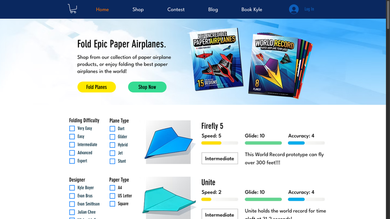

[Foldable Flight](https://www.foldableflight.com)，HN 1,284 分。得先说一句：它不是那种能点开逐步折的交互站——首页写着 "Click on any plane to fold it!"，点进去是**嵌一段 YouTube 教程视频**。评论区有人骂得很具体：点开第一个设计，唯一的学习方式是一个十分钟的视频，还带着凑时长的水词，不然就得买他卖的那本书和模板，否则只能把视频暂停一百次。

但站本身有真东西。109 款独家设计，按纸张规格分 A4 / US Letter / Square 三档筛选——这个细节说明作者真的折过，欧洲用户从小被 Letter 尺寸的书坑过。每款带三个十分制评分：速度、滑翔、准度。

护城河是两个世界纪录设计：**Firefly 5**（设计者 Wang Chenghao）是飞行距离纪录原型，能飞超过 300 英尺；**Unite** 是滞空时间纪录，31.2 秒。作为参照，经典的飞镖纸飞机大概飞 20 到 30 英尺，他站上很多简单款都能过 100 英尺。这两款是竞品 foldnfly 拿不到的——那边有真正的分步图解，但拿不到世界纪录。

站长 Kyle Boyer 一个人，主业是 YouTube 频道，网站用 Wix 拼的，他在 HN 里自称 sole proprietor、承认没有网页设计经验、现场问大家弹窗怎么记住用户选择。他的书《Foldable Flight's Incredible Paper Airplanes》是大学的毕业设计——他学的是平面设计，当年画自己发明的纸飞机说明书，梦想出本书，最后真把它写成了毕业作品。现在这本书约 20 美元在预售，外加可打印模板、Patreon、和 PowerUp 电动套件的联名。

这条在 HN 火到 1,284 分，靠的不是技术，是三层叠加：纸飞机是这代人共同的童年记忆（最高赞之一是疫情期间靠这个频道和五岁孩子熬过来的父亲）；109 款设计确实没在别处见过；以及站长本人在评论区挨骂还认真回复。有条评论把它总结成了 HN 的审美偏好——把一件事做到极致、长期一致、近乎偏执，核心价值免费给，但让人极容易付费升级。Kyle 回了一句："Obsessive is certainly a fair description of me."

### AWS 发布了个模拟器，代码没有一行是人写的

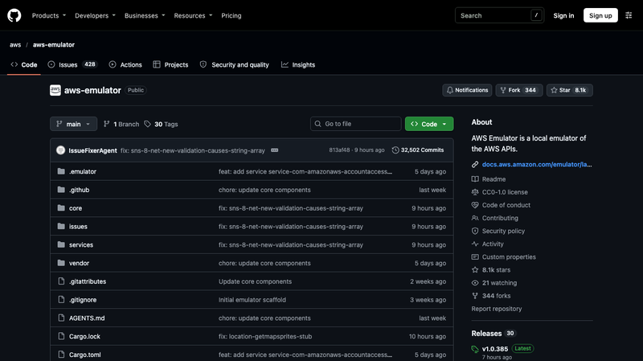

[AWS Emulator](https://github.com/aws/aws-emulator)，HN 988 分，现在 8,136 星，CC0 1.0。它是个本地 AWS API 模拟器——起一个 HTTPS 假端点在 `127.0.0.1:9297`，你把 SDK 的 endpoint 指过去，代码一行不用改就能在 CI 里跑测试，不需要 AWS 账号。覆盖 **438 个 API model**，一个服务一个 Rust crate。

但模拟器不是重点，LocalStack 已经做了十年。重点是官方博客标题就交了底：**"built 100% by autonomous AI agents"**。团队没写一行代码，也没 review 任何一行。

起因是个周末实验。作者看到 Anthropic 那条「AI agent 能自主造出 C 编译器」的研究，想到一件事：只要给「明确的 spec + 参考实现」，agent 就能忠实实现它——而 AWS 恰好两样都有，AWS API Models 是 spec，真 AWS 云是参考实现。他给 Kiro 下了三步指令：基于 CLI 写测试、迭代到这些测试在真 AWS 上通过、再造一个内存实现让同一批测试也能通过。Kiro **15 分钟**给了个能跑的 SQS，一个周末把剩下整个 AWS 搭了个大概。

真正的工程在这里：三队 agent 的流水线。第一队从公开 API model 出发设计真实场景测试（建队列→发消息→收→ack→删），每条都先在真 AWS 上验证通过才收进仓，累积**数万条** fidelity test。第二队拿这些测试重放打模拟器，把失败按根因分组写进 `issues/things-that-do-not-work/`。第三队一个 agent 领一个 issue、root cause 后改代码，然后必须过 merge gate：能编译、编码规范 agent 审、安全 agent 审、**不许让 fidelity 分数回退**。全过才进主线。规模是每天修掉数千个 issue，数百个 agent 同时在同一个代码库上干活，两个月发了 385 个版本。

两个设计值得单独记。一是**未实现的 API 一律返回 HTTP 501 `NotImplemented`**，绝不静默返回假数据——测试宁可显式失败，也不要假绿。二是每个 release 都公开各服务的 fidelity 分数（通过的测试数除以总数），测试集开源，连没通过的也放出去。

HN 上的反应很分裂。一边是「RIP LocalStack」，一边是冷水：三周约三万次 commit 能有什么质量保证，是不是有人靠 token 刷晋升；还有人翻出仓库里 Opus 5.5 之前过度使用的词（比如 `load-bearing`），推断用的是旧模型。而作者在博客里正好回答了这些——他说看到这种结果很容易觉得 AI 什么都能造，但**做出一件你敢放到客户手里的东西，仍然需要严肃的工程投入**。早期 agent 为了支持 Lambda 甚至自己写了个 Python 解释器，后来才被要求优先复用现成库。门槛不在写代码，在造护栏。

### .name 域名被祖父条款保了二十年

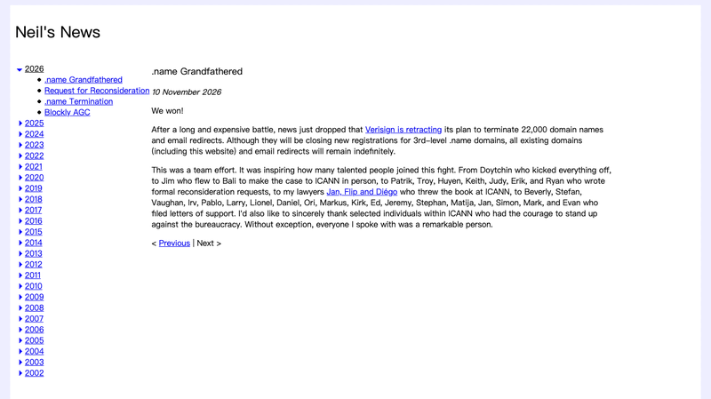

Neil Fraser 的[这篇记录](https://neil.fraser.name/news/2026/11/10/)，HN 936 分。作者在 Google 干了二十多年，是 Blockly 的作者、Dart 早期团队成员、diff-match-patch 的作者。他在 2002 年前后注册了 `neil.fraser.name`，女儿出生几分钟后注册了 `beverly.fraser.name`，续费到 2040 年。

`.name` 是 2001 年那批新顶级域里专门给人名用的 sTLD，注册形式就是 `first.last.name` 这种三级结构，注册局自己运营三级空间。荒诞的地方在于：他当年选 `.name` 的原因之一就是不想用 Verisign，几年后 Verisign 把运营它的 Global Name Registry 收购了。

后面的剧情是：Verisign 今年 4 月向 ICANN 提案作废整个 `.name` 三级层——约 22,000 个域名——理由是简化后台管理。ICANN 在 7 月 28 日批准了。通知邮件大量进了垃圾箱，有人打电话问注册商，被告知「这是诈骗，别理」。原定下线时间是 2027 年 2 月。

9 月 3 日他发文《.name Termination》，10 月 4 日递了 17 页正式复议申请，请了律师，几十人跟进。11 月 Verisign 撤回计划：停止接受新的三级 `.name` 注册，但**存量域名和邮件转发被祖父化，无限期保留**。

他最刺眼的一句话是关于续费的——Verisign 在整个过程中照常收钱，他特意测试续费到 2040 年，付款流程一路正常：**"Verisign is accepting payment for a service they have no intention of honouring."**

为什么这事比「一个域名没了」严重得多：域名清空后二级域 `fraser.name` 会被释放，任何人注册它就能重建 `neil.fraser.name`，从而接管所有绑定这个邮箱的账号、用他的身份提交代码、控制他家里的 IoT 设备。邮箱是绝大多数账号的恢复凭据，二十五年积累的账号根本没法枚举。这不是网站没了，是身份被冒名。

历史上顶级域消失是因为国家解体，比如南斯拉夫的 `.yu`。这回只是注册局想省事。如果这能成，任何 TLD 的稳定性都不再可信。

HN 上最该被记住的一句评论是：有名气的人能请律师、能上 Hacker News，那另外 21,999 个普通人呢。

### Rust + WebGPU 写的木工建模器，能做榫卯

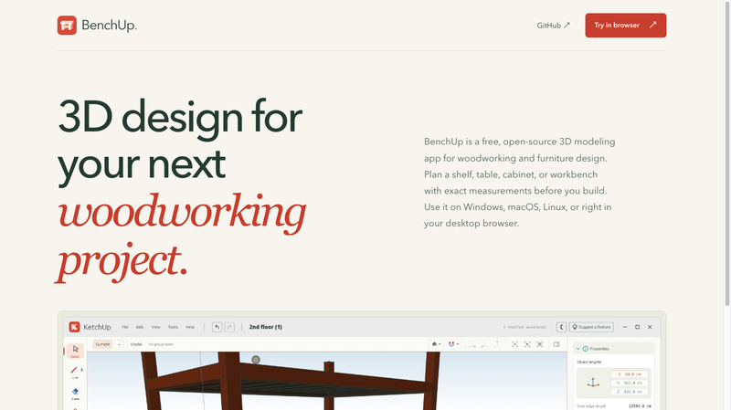

上 HN 的时候它叫 [KetchUp](https://ketchup3d.github.io/app/)，770 分，标题是「开源的 SketchUp 替代，Rust + WebGPU 写的」。现在仓库改名 **BenchUp** 了，定位也收窄得很明确：木工和家具设计的 3D 建模，不是通用建模工具。

改名的原因挺直白——KetchUp 和 SketchUp 只差一个字母，HN 第一条评论就在说这名字是在邀请律师函，还举了 Mikerowsoft 对微软的先例。作者在评论区认了：看到一堆 star 之后自己也觉得该改名，本来打算叫 Dovetail3D，最后落成 BenchUp，顺便把定位从「SketchUp 克隆」收成了「木工设计工具」。

这个转向其实更聪明。SketchUp 的推拉、捕捉、组件那套交互是它最有用的部分，但通用建模市场早被占满了；而木工建模真正的痛点在于**板材、榫卯、精确尺寸**——这些 SketchUp 免费版根本不给你算。

功能上它做得相当实：画板、开榫、组装，榫卯类型覆盖到**直榫、半搭接、企口、槽榫、燕尾榫、指接榫、饼干榫、多米诺（圆木榫）、开槽、槽加圆木榫**，还支持斜接。接头参数带实时预览，两块板任一移动，动态接头自动跟着更新；有加工诊断和切割导向，接头处多余料能修掉而原始板材仍可编辑。饼干榫和多米诺的槽有可调的宽度、厚度、插入深度和数量。

木纹是程序化生成的：给组和组件设定纹理方向，模型上直接显示木纹走向参考线，转到任何角度都能看到纹路怎么穿过整块板和整套组装；材质目录里能调木色、表面处理、砂光工序，工时和干燥时间会算进项目估算。还有个 Router 工具，选中一条边就能在属性里选倒角、圆角、凹槽、罗马线脚、珠边轮廓，之后随时改或移除而保留原始板材。

技术栈是 Rust 编到 WebAssembly，`egui` 做界面、`wgpu` 做渲染（优先 WebGPU、自动回落 WebGL2），所以同一份编辑器跑原生 Windows/macOS/Linux，也在浏览器里跑。几何内核是自己写的**双精度** B-rep 平面面片模型——这个细节决定成败：Three.js 那类 Web 3D 默认 float32，坐标一大就抖，而木工和建筑尺寸用双精度是刚需，这才是它敢标「精确测量」的技术根据。三个 crate 分得也干净：`benchup-core` 只管双精度几何、捕捉推断和撤销历史，完全不依赖 GUI 和 GPU；`benchup-app` 负责 egui 工作区和 wgpu/WGSL 边缘渲染；`benchup-cli` 带一个**内置 stdio MCP server**，shell 或 AI agent 都能直接读写 `.bup` 文件。

工程文件是 `.bup`，兼容旧的 `.k3d` 和 `.ketchup`，能导入 SketchUp 的 `.skp`、导出 Wavefront `.obj`。880 星、57 fork、378 个提交，MIT。

它也不是没有问题。HN 上最实在的批评都在交互上：每个矩形都得先命名、推拉之前要先选中、默认不吸附网格——这些是「能用」和「好用」之间的差距。README 自己也很克制，只说验证过 Cargo 检查、核心与 UI 交互测试、离线渲染冒烟测试，Windows/macOS 和浏览器的启动流程仍标着需要冒烟测试。正面评价倒是一句到位："Impressive how good this Rust UI feels in a browser though. Even the text rendering is impressive."

我觉得这个案例值得记的不是「又一个开源替代」，而是**收窄范围反而让它有了存在的理由**。做通用 SketchUp 替代，永远只能做到「免费但功能少」；专做木工，才有可能做出 SketchUp 不会做的东西——榫卯自动生成、木纹方向、切割导向。浏览器里跑也顺带解决了小作坊的部署问题：不用装，打开就能算料。

### 绣花机要订阅费，他用 Rust 重写了一个，还接了 MCP

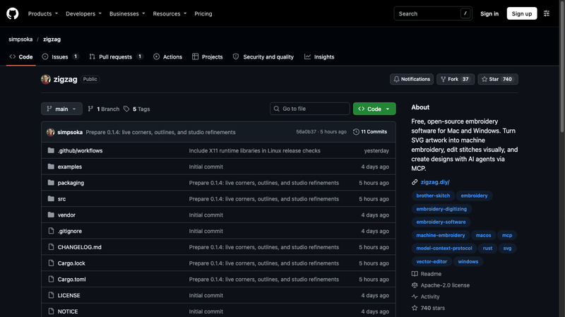

[ZigZag](https://github.com/simpsoka/zigzag)，HN 739 分。作者 simpsoka 的标题把动机说完了：「我那台 300 美元的绣花机要订阅费，所以我给自己写了个 app。」她的另一个身份可能更有说服力——Kathy Korevec，前 GitHub Docs 负责人。

机器是 Brother Skitch PP1，必须配 Brother 的 Artspira app 才能用：免费版功能被砍，完整功能和一部分素材要订阅。评论区有人一句话总结得比什么都准：**"The supplied software is truly terrible."**

ZigZag 是个 Rust 写的可视化刺绣编辑器，核心流程是把 SVG 转成针脚，在编辑器里微调，然后导出 **PES、DST、EXP、JEF、VP3、PEN** 六种格式——覆盖 Brother、Janome、Husqvarna Viking、Melco 和任何读 DST 的商用机；或者直接通过蓝牙发给 Skitch。界面用的是 egui + OpenGL（glow），所以同一个引擎桌面跑得动，命令行工具 `zigzag` 也是同一套。

它最有意思的设计是内建 **MCP**。编辑器在 `127.0.0.1:7878/mcp` 上跑一个 Streamable HTTP 的 MCP server，另有 `zigzag-mcp` 做 stdio 转发，Claude Desktop 里加一行配置就能让 agent 直接读写你正在看的那份文档——左侧有 Agent 面板，⌘K 唤出，可以让 agent 画，也可以自己画。有个设计我很喜欢：**每次 MCP 调用等于一步 undo**，agent 乱画也能一键退回去。作者把「在 Illustrator 里画、在 ZigZag 里画、或者让 agent 画」并列成三种等价入口。

跟机器的通信这块有点野。走文件的话是标准做法：导出文件丢 U 盘。直连 Skitch 走的是 **BLE 协议逆向**——`src/machine/` 里用 `btleplug` 自己实现，窗口按「连接·归位·发送·试绣·开始绣·完成」五步走，像个切片软件的设备页。README 里有一句很实在的警告：协议是逆向来的，所以**别升级固件**，升了可能就不通了。另外这个 BLE 通道同时只能连一个 app，用 ZigZag 之前得先把 Artspira 关掉。

工程质量也不含糊：136 个库测试加 153 个编辑器与 MCP 测试，UI 交互用 egui_kittest 做。Mac 版有 Homebrew cask、签名公证、应用内更新，Windows 给 zip，Apache-2.0。作者也坦承开发过程用了 ChatGPT 辅助。

评论区里有条话说出了这件事的普遍意义：我们应该用 LLM 逐个干掉订阅模式，直到硬件就只是硬件、不带任何附加条件。还有人说这是 Claude 帮着写的（二〇二六年四季度的概率确实站在他那边），但无论如何——三千块的机器配一套烂软件还按月收费，而现在有人用几周时间证明这东西根本不需要订阅。作者后来还提到有 YouTuber 在做面向工业机的同类项目，这条路显然不止一个人在走。

### 苏格拉底教学法，写成了一份 SKILL.md

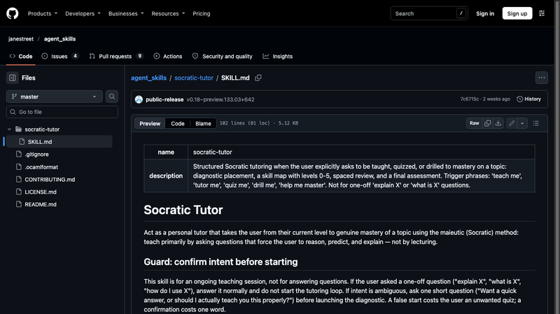

[Socratic Tutor](https://github.com/janestreet/agent_skills/blob/master/socratic-tutor/SKILL.md)，HN 710 分。它不是一个软件，是一个 5.12 KB 的 Markdown 文件——没有脚本、没有依赖、没有模型，躺在 Jane Street 官方组织仓库的 `socratic-tutor/SKILL.md` 里（同目录还留着 `ocamlformat` 配置，金融公司的 OCaml 底色在这也看得见）。全部能力来自对 AI 行为的约束。

约束得相当具体。技能地图分 0 到 5 级：0 不知道，1 听过，2 能跟上，3 有帮忙能做，4 能独立做，5 能教别人且处理得了边界情况，每变一级就用方块字符重画一次进度条。教学循环最狠的一条是：**一次只问一个问题，问完立刻结束这条消息**，不追加提示、不追加示例答案、不追加任何教学内容。这恰好顶着 LLM 最顽固的本能——问完顺手把答案也说了。答错时也不给答案，而是问一个更窄的问题让矛盾自己露出来，连续两三次失败才直接解释，解释完立刻换个角度重测同一个概念。

评估部分写得更像军规。等级是挣来的不是给的：需要两次以上独立检查，其中至少一次必须是**无提示回忆**——不能是刚被告知答案之后的重复。模糊或部分正确的回答一律不算对。不定期抽查旧子技能，挂了就降级。5 级要求能扛住对抗性问题，并且讲清楚到"你愿意让他去教别人"。原文有句话值得单独摘出来：**"Do not flatter. 'Not quite — why would X happen if Y were true?' beats 'Great try!'"**

我觉得最有意思的是 `just tell me` 这个命令。它承认苏格拉底法有时候就是烦人，用户有权在当前这个问题上临时退出教学模式，直接要答案。没有这个逃生口，纯苏格拉底式教学会变成折磨——这也说明作者真把这套东西用在人身上过，而不只是写了个漂亮的 prompt。

不过它的软肋也很清楚：整套评估规则靠模型自律执行。没有外部校验，"等级是挣来的"就只是一句自我要求，模型想讨好用户的时候随时可以偷偷放水。唯一的留痕手段是 `save state` 输出的状态块——把它存到外部，才有资格谈"这个人真的学到 4 级了"。

### 一个假烟雾报警，差点淹了 Jane Street 的数据中心

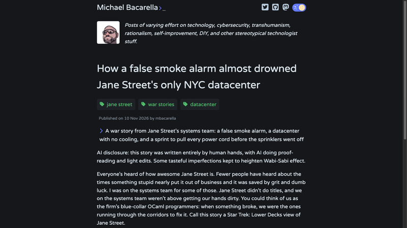

[Michael Bacarella 的回忆](https://michael.bacarella.com/2026/11/10/false-smoke-alarm-jane-street-datacenter/)，HN 587 分。他当年在 Jane Street 系统团队，这是一个关于"三个合理设计串成一条荒诞因果链"的故事。

先说机房为什么在交易大厅隔壁。Jane Street 长期坚持这么做，10 个人时算可爱，150 人时开始变怪。两个理由：怕服务器被偷（里面是交易策略），以及要确保失控的自动交易系统能被**跑过走廊拔电源**关掉。工具当然有，但公司在这件事上走得"令人恼火地慢"，坚持保留拔电线这最后手段。这种风险文化来自一位在核潜艇上服过役的 partner——作者概括得很准：在潜艇上，你不能信任自动化，除非有个涂成红色、机械连接的拉杆能把它关掉。

机房后来长成一套正经设施：在线式 UPS、CRAC 空调机组、冰箱大小的交换机、地下柴油发电机、十排乘十深的机柜，全塞在曼哈顿 1 New York Plaza 的中间楼层里。

事故起因很小：承包商在隔壁准备间切割施工，粉尘飘起来触发了烟雾报警。但危险不在这里。喷淋系统平时管道是空的（省得常年担心顶上漏水），烟雾报警触发后管道**加压充水但不喷**，真正喷水要靠每个喷头自己的热敏塞——周围空气够热才开。逻辑是：报警既然是真的，火没被控制住所以才会热，那就该浇水。同时为了不给火送风，烟雾报警还会**自动关掉 CRAC**。

于是链条闭合了：粉尘误报 → 空调停机 → 机房没有冷却，温度一路往上 → 爬到阈值 → 喷头自己打开 → 服务器全淹。作者那句话写得很平："满装机柜的房间对制冷需求极高。"

他当时住步行 9 分钟的 200 平方英尺公寓，一直跟团队炫耀这点，也意味着紧急情况时他就在附近。某天下班刚进电梯，香港办公室打来电话——香港那边有纽约的问题时，打的是他的号。他跑过金融区那条名字讽刺地叫 Water Street 的街，冲进大楼，等电梯爬 33 层，刷两道门禁，进机房时像进了桑拿房，然后一排排、一柜柜地用双手拔电源线。温度最后停在 143.6°F（约 62°C），阈值是 150°F。

纽约主要市场当天已收盘，停机损失极小，第二天早上恢复。善后会议他也不忘澄清：别想象 Gordon Gekko 冷血地决定谁要滚蛋，Jane Street 的会"就事论事、头脑清醒，甚至有点好玩"。

这个故事最好的一层讽刺在于：机房挨着交易厅本来就是为了能跑过去拔电源，这个设计最后真的救了一次场，只不过救的是"服务器被自家灭火系统淹掉"，而不是"失控的交易系统"。防御系统自己变成了攻击面。

### 用 SGP4 算，这周哪些卫星拍过你

[watched.earth](https://www.watched.earth)，Show HN 491 分。首页一句话就把人钉住："Something watched **you** this week." 输入地球上任意地点，它列出过去七天从你头顶飞过的每一颗卫星，以及它们实际拍下的照片。

数据是硬功夫。CelesTrak 发布公开轨道根数（源自美国太空军的追踪数据），站点每六小时抓一份新副本，这次加载了 **16,881 个对象**。然后对每颗卫星跑 **SGP4** 标准轨道模型，把过去七天逐个推演一遍，记录你的位置何时落进它能看到的地方。全部计算在浏览器里完成，只用公开数据。

它比同类站点严谨的地方在于把"能看到"拆成了四种情况。直下视野：Sentinel-2 幅宽约 290 公里，Landsat 约 185 公里，你必须在这条带子里。可倾斜相机：大量商业卫星能倾 30 到 45 度，落在可达范围就标注"可能指过这里"，而不是假装确定。白天：普通光学相机需要太阳，夜间过境永远不算拍到。雷达：Sentinel-1 不需要光，发微波收回波，穿云也能夜间成像，而且是侧视的，影像同样公开、用灰度显示——亮的是粗糙地面和建筑，暗的是平静水面。

影像来自 Microsoft Planetary Computer、Element 84 和 NASA 的归档，每张都匹配到真正执行那次过境的那颗卫星。站点结尾写着一句："MADE FROM PUBLIC DATA. WE DIDN'T TAKE ANY OF THESE PHOTOS."

最有意思的是 FAQ 里那段自拆台脚。**"能拍到我吗？不能。最好的情况一个像素跨 10 米，一辆车占一个像素，你不在里面。"** 还有"这是全部卫星吗？不是"——军用和间谍卫星大多不在公开目录里，公司也不会说相机指向哪。它先用"有什么东西在看着你"把人钩住，再立刻用分辨率把人放回来。

这个诚实在同类产品里很少见。绝大多数"卫星监控地图"会让你以为天上全在盯着你，它反过来告诉你：290 公里幅宽、10 米一个像素、7 天重访——这些具体数字比任何耸动标题都更能让人判断自己到底在不在视野里。真正盯着你的那部分不在 CelesTrak 上，它说得清清楚楚，剩下的价值就是给你一个尺度感。

## 订阅
这里会不定期分享我看到的有趣的内容（不一定是最新的，但是有意思），因为大部分都与机器有关，所以先叫它"机器文摘"吧。

Github仓库地址：https://github.com/sbabybird/MachineDigest

喜欢的朋友可以订阅关注：

- 通过微信公众号"从容地狂奔"订阅。

