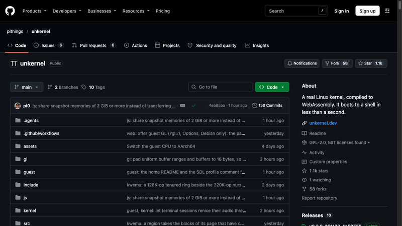
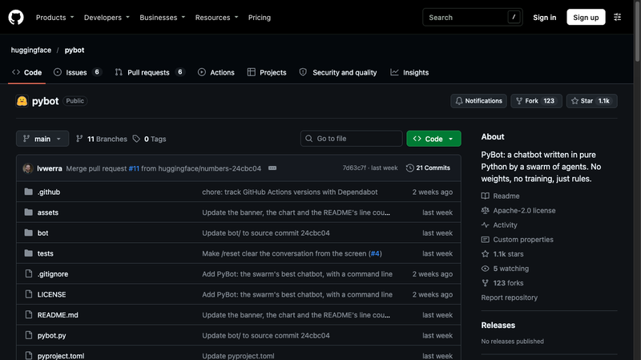
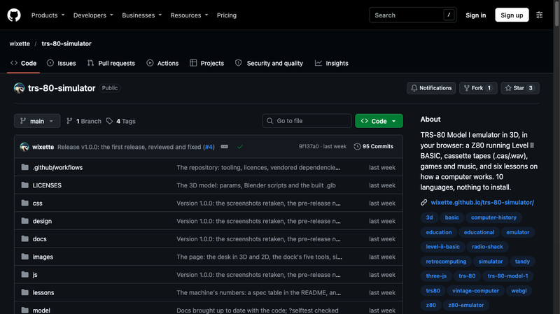
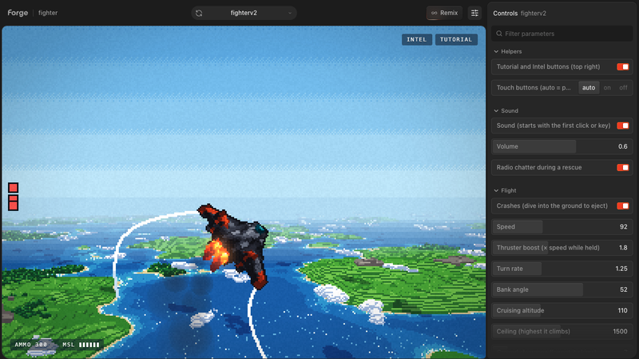
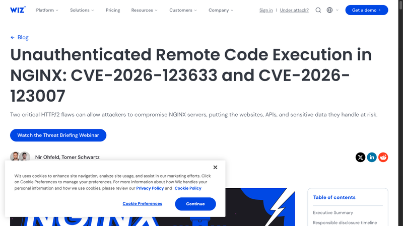
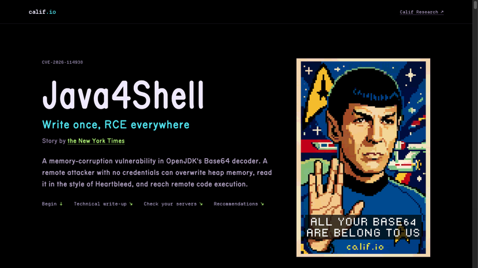
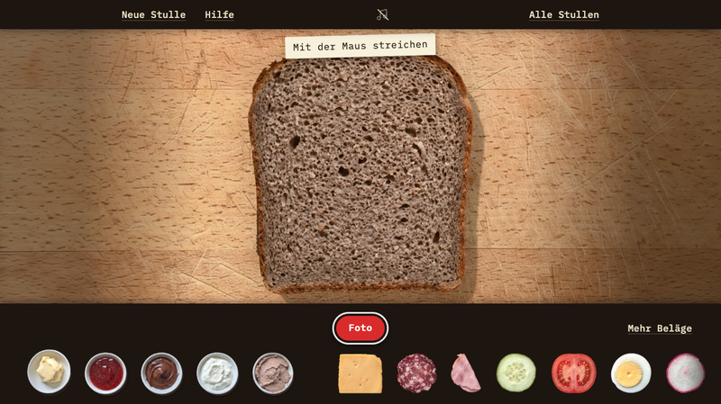
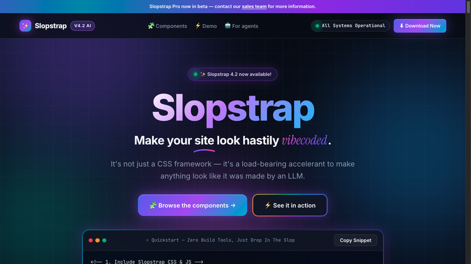

# 机器文摘 第 196 期

### 真 Linux 内核编译成 WebAssembly

[unkernel](https://github.com/pithings/unkernel)，1.1k 星，仓库 11 月 12 日才建，十天涨到千星。它和过去所有“浏览器里跑 Linux”的项目都不同：那些是拿模拟器跑整台机器，它把 **Linux 7.x 内核本身编成单个 wasm 模块**——调度器、内存管理、ext4、TCP/IP 都是真代码编译的产物。

用户态才是模拟的。作者用 Zig 写了个 aarch64 CPU 叫 kwemu 链进内核，直接走内核自己的页表（真 MMU，Sv39），跑**未经修改的 arm64 二进制**。翻译分两层：解释器解码成紧凑 op，热代码 JIT 编成 wasm 模块。任务切换靠 JSPI（WebAssembly.Suspending）给内核可挂起的真栈，这是 fork、/proc、cgroups 全部做对的原因。

代价写得很清楚：没有 IPv6，UDP 只支持 DHCP 和 DNS，不接外部入站；没做 ptrace 寄存器组，strace 和 gdb 都用不了；没做 seccomp。联网要过 Wisp 代理。一次 wasm trap 直接结束会话。

我实测了 unkernel.dev：下载 10.3 MiB 的 wasm 加 69.4 MiB 的 Debian 镜像，4 核机器 6.19 秒进 Debian 13 的 shell。README 那个“0.3 秒”默认是 Alpine 小镜像，别当 Debian 的速度。慢得值——fork 是真的 fork，进程树、资源限额、文件系统语义都对。

### 一千个 agent 写了 64 万行 if-else

[HuggingFace 官方发的 pybot](https://github.com/huggingface/pybot)，1,117 星，总共只有 21 个 commit，因为代码是整块灌进去的。bot/ 下 528 个 Python 文件，约 **64 万行纯规则代码**，外加 55 万行 agent 自己写的测试。唯一依赖是 Python 3.8+，**没有模型、没有权重、没有训练**。

写它的是“超过一千个 agent”，灌了五千多个版本进去。网上盛传的“DeepSeek Flash”在仓库里查不到出处，我不写死这句。

架构比一个大 if-else 讲究：四个共享底座——understanding 2.5 万行、memory 10.9 万行、knowledge 31.7 万行、compose 10.4 万行——每轮各模块分别提议回复，由 arbiter.py 仲裁选一条。更像规则议会，不是巨型判断树。

效果：自家 SmolTalkBench 上用 LLM 判官比，胜率从 0% 提到 **26%**，对标 SmolLM-360M-Instruct，也就是四分之三答不对。公开 issue 更有看头：#22 说支持 3.8，实际在 3.9.6 上 safety 正则就崩，用了 3.11 才有的语法，错误被吞掉，那一轮安全检查直接跳过。

价值不在 26%。1966 年的 ELIZA 就是规则系统，六十年后一千个 agent 不分昼夜地写规则，把上限推到 26%——它标出的是**规则工程的天花板在哪**。

### 五十年前的机器，可以按真实顺序拆

[TRS-80 Model I 模拟器](https://github.com/wixette/trs-80-simulator)，star 只有 3 个，但这是 11 月 14 日建库、上周刚发 v1.0.0 的新项目，wixette 一个人做的。

它不是“用 3D 画个外壳给模拟器套上”。Z80 核是 Molly Howell 的 Z80.js（MIT），按 T-state 精确跑在 1.774MHz，跑真的 Level II BASIC 1.2 ROM 加 16KB RAM，视频 RAM、键盘矩阵、磁带口都在——磁带 500 bps，读 .cas 和 .wav。机器本体靠实测参数和主板网表在 Blender 里脚本化建模，three.js 绘制，网页是纯 JS module。

验证做得比 star 数像样：单元测试在真 ROM 上端到端跑完六节课和全部 19 个程序，Z80 核通过了 ZEXDOC——查 Z80 指令实现正确性的老测试套件。

能玩的：通电外壳变玻璃，看得见哪块芯片在发光；关机后按真实顺序拆机；屏幕 1024 字节逐位可视化；磁带能看比特波形；CPU 能单步。含简繁中文共 10 种语言。缺 Expansion Interface，没磁盘、打印机、扩内存；原版软件没带，版权说不清。

star 数 3 是这种项目的常态。它不是模拟器，是**一本能上手的计算机原理教材**——从比特、波形、指令周期往上搭。

### 32KB 的打飞机，一行美术资源都没有

[一个 32KB 的网页](https://forge.ui8.ai/share/frag_1eb8944c-57b1-42ca-a909-5c2d7e517c24)，没有 3D 引擎，纯像素渲染，整页只有一个 HTML。点进去就是一架战斗机掠过像素化的海面和岛屿，拖一条白色尾迹，右下角挂着飞行参数面板。

里面全是真的：速度 92、推力增压 1.8、转向率 1.25、倾角 52、巡航高度 110、升限 1500，每个都能调。俯冲撞地就弹射，还有救援时的无线电通话字幕。地形是体素风格的方块海和方块山。

关键在“没有美术资源”的字面意思：贴图、模型、动画全由算法运行时生成，没有图片、没有 glb、没有预渲染视频，整页体积比一张手机照片还小。

这类东西最近忽然多起来，原因不难猜——模型写渲染代码的能力过了某个阈值。值得记的是它的经济含义：**长视频渲染的成本模型可能要改**。过去做一段实时演算画面得有引擎、资产、渲染农场，现在是一段代码加浏览器。剩下的问题只有一个——谁来质检，谁来签字。

### 十多年的洞，默认配置就能打

[Wiz 披露两个 NGINX 的 HTTP/2 漏洞](https://www.wiz.io/blog/nginx-http2-rce-vulnerabilities)，CVE-2026-123633 和 CVE-2026-123007，CVSS 4.0 都是 **9.2**，未授权远程代码执行。

第一个洞在代码里躺了十年多（影响 1.9.5–1.31.8）。机制像教科书案例：HTTP/2 流被取消时，已扣掉的 `h2c->send_window` 被无校验退回，计数器超过协议允许的窗口上限；后面那个“还剩多少空间”的边界检查用无符号减法，下溢后限制被绕过，越界长度顺着 `ngx_ssl_send_chain()` 变成越界内存拷贝。**默认配置下即可利用，正常提供静态文件也能被打。**

第二个是存在六年的 use-after-free（影响 1.19.7–1.31.8）：连接进了“可复用连接”列表没及时移出，槽位紧张时 NGINX 关掉并释放它，而正在处理的请求还捏着指针。主要影响反向代理配置。

ASLR 挡不住——攻击者可以先用同一缺陷读内存。没观测到在野利用，Wiz 暂时不发 PoC。修的话升到 1.30.7（stable）或 1.31.9（mainline），NGINX Plus 升 37.0.7.1 / 37.0.8.1。升不了就关 HTTP/2：1.25.1 及以上写 `http2 off;`，并从 `listen` 里去掉 `http2` 参数。

WAF 和 CDN 帮不上忙，除非它自己终结 HTTP/2 再改写请求。查一下你的服务器，这比读文章重要。

### 一串 Base64 就能打穿 JVM

[Java4Shell](https://calif.io/java4shell/)，CVE-2026-114938，CVSS 4.0 也是 **9.2**。OpenJDK 17.0.6 及以上全部受影响，Corretto、Temurin、Zulu、Liberica、SapMachine、GraalVM 一个跑不掉。

漏洞在 HotSpot 的 x86-64 Base64 intrinsic 里——就是那段手写 AVX-512 汇编的加速例程。输入尾部带填充字符 `=` 时，输出长度算出 0，再减 1 或 2 就下溢成 -1 或 -2；`bzhiq` 在 output_len ≥ 64 时不改位，store mask 变成全 1，`evmovdqub` 一口气写 64 字节，越过 50 字节结果数组的末尾。触发只要在 JDK 17+ 里解 `'A'*64 + '='`。Java 之后照样抛 IllegalArgumentException，但内存已经坏了。

**这是硬件相关的**：只有支持 AVX-512 VBMI 的 x86-64 才中，Intel Ice Lake 之后的 Xeon、AMD Zen 4 及更新，ARM64 不受影响。用 `grep -m1 '^flags' /proc/cpuinfo` 看，得同时有 `avx512f`、`avx512bw`、`avx512vbmi`、`bmi2`。

写入的是固定值，但配合堆布局（Heap Feng Shui）可以改数组长度，先做出读原语泄堆内存（文中叫 JavaBleed），再升级成任意写，改 Code Cache 和 JVM hook 就能执行代码。文里演示了 Keycloak、Jira、Confluence、Artifactory、Jenkins、PingFederate 的**免登录 RCE**。Oracle 和 OpenJDK 已在 11 月 17 日发补丁，临时缓解加 `-XX:-UseBASE64Intrinsics`，或 `-XX:UseAVX=2`（仅 x86-64，ARM 加了 JVM 起不来）。

有个细节：6 月 9 日就有人在生产里撞到它崩溃并提了 issue，9 月有人提交修好的 PR 被关闭，直到有人证明能利用才真正修。

### 一块显示器，把下载速度砍掉 75%

[Oscar Molnar 的排查记录](https://blog.tymscar.com/posts/studiodisplayethernet/)，2.5 Gbps 对称宽带，某天下载只有 600 Mbps，上传却还有 2.4 Gbps。

ISP 没问题，路由器没问题，网线直连、USB 网卡直连 Mac 都跑 2.3 Gbps。问题出在他把外设全接到 2026 款 Studio Display XDR 上、走“一根线”之后。网卡是绿联的 USB-C 转 2.5G（Realtek RTL8156B），挂在显示器 USB Hub 下。关键现象：走显示器时 ping 有约 10% 丢包，但 macOS 日志里没有丢帧记录——包在到电脑之前就丢了。

换 Realtek 官方驱动升到 1.1 Gbps，打开路由器的以太网流控升到 2 Gbps——但他不想常开流控，那会给游戏机加延迟。

于是他拿 Linux 主机发恒定速率 UDP，读网卡自己的计数器：直连 Mac 几乎零丢帧，经显示器时转发给 Mac 的帧率在 **每秒约 168,000 帧（≈2 Gbps）处死钉住**，多出来的全丢。根因是 USB 批量传输的突发机制——USB 3 设备每发一批要等主机回 ACK，SSD 硬盘盒一次发 16 个包，这块网卡只发 4 个 1KB 包。等 ACK 穿过显示器 Hub 平均 7.6 µs，发包要 8.2 µs，加起来把上行速率锁在约 2 Gbps，低于 2.5 Gbps 的入口速率，缓冲区积压丢包，TCP 一退避速度再掉。换成绿联 5G 网卡（RTL8157），`bMaxBurst` 从 3 变成 7，2.4 Gbps 零丢帧。

这事的价值不在苹果又不行了，而在它是一次干净的工程推理：分层排除，用计数器在瓶颈处取证，再从协议层推出机制。

### 三明治模拟器

[stulle.app](https://stulle.app/)，德语，作者 Gregor Weichbrodt 做了个抹面包的玩具。

单片黑麦面包上抹黄油、果酱、榛果酱、夸克、肝肠泥，再从约 40 种配料里拖：香肠、奶酪、酸黄瓜、番茄、煎蛋、生鱼片、香蕉、猕猴桃、鱼条、薯条、橡皮糖。有**刚体物理**：配料会掉落堆叠，洋葱圈在煎蛋上会滑，黄瓜片推过面包边会翻到砧板上；三文鱼、火腿、奶酪这些软体会自然垂坠。照片模式四个机位，点了保留会生成编号和链接。

页面写着“无分数、无等级、无账号、无广告”，十月上线至今做了 3.7 万多个三明治（页脚编号已到 38,742 号）。

它没什么技术含量，妙处全在克制：物理参数没夸张，洋葱圈滑落、软料垂坠是真调过。一个没有关卡、成就、排行榜的网页，靠抹面包让人做出三万多个成品，这在当下很稀有。

### 让网站看起来像 AI 随手糊的

[Slopstrap](https://slopstrap.mikelacher.com/)，作者 Mike Lacher，以做讽刺类网页项目闻名。口号是“让你的网站看起来像是被 AI 随手糊出来的”（Make your site look hastily vibecoded）。

它把 2025–2026 年 SaaS 和 AI 落地页的俗套元素打包成可直接复制的类名：闪烁的双环状态点、彩色左侧粗边框、带虹光的渐变按钮、渐变标题文字、正文里随机一个斜体衬线词、手写马克笔下划线、玻璃卡片、不对称 bento 网格、滚动触发的数字计数器、自动填充 OpenAI/Stripe/Vercel/YC 标志的跑马灯、合成名人证言，以及按行业生成的空话段落。

零构建，引 CSS 和 JS 就行，`Slopstrap.slopify(selector)` 一键涂抹，`unslopify()` 还原，还有个 `/agents` 页面专门给 AI 代理读使用说明。

这东西好笑，因为它是**可判定的**。过去说某些页面“AI 味重”是感觉，现在有人把这种感觉做成了类名清单，打开 DevTools 就能核对。另一面：既然风格可被枚举，它离被识别、被规避、被流水线化就不远了。

### CMU 把课免费放到 YouTube

[cs.cmu.edu/learn](https://www.cs.cmu.edu/learn/)，口号是"Computer science from Carnegie Mellon. Free, online, at your pace."

已上线 8 门课：Machine Learning with Large Datasets、Principles of Computing、Principles of Software Construction、Machine Learning Systems（陈天奇、贾志豪）、Software Architectures、Quality Management、AI Agents（Daniel Fried、Graham Neubig）、Machine Learning in Production，2027 年 1 月再加五门。

现阶段只有 **YouTube 的完整课堂录像**。“自定进度课件”标着即将推出，那一步会基于真实 CMU 课程做即时反馈、发数字徽章，但不给学分，再往后加 AI 助教。页面明说想要评分作业和官方证书请走 CMU Online。项目由学生团队在 ScottyLabs 支持下开发，不是教务处的产品。

值得留意的是顺序：先放录像，再做互动课件，最后加 AI 助教。这跟很多学校“先买个大模型再想怎么用”正好相反——**内容是底座，AI 是最后一层**。

### 十年前的修复 PR

这两件安全事的相似之处，比版本号更值得记。NGINX 的两个洞分别存在了十多年和六年；Java4Shell 是六月有人在生产里撞出崩溃、九月有人提交过修好的 PR 被关闭，直到有人掏出能打的 PoC 才真正修。三次都是同一个模式：**已知、可修、没修**。

另一条线：这周披露的 NGINX、Java4Shell 还有 PHP2Shell 出自同一批研究者，都在公开说“用了 AI 找洞”——Wiz 用自家 Atlas 加 Gemini 和 ChatGPT 做验证，Calif 说用 Codex 花了不到 200 美元。HN 上为此吵得不亦乐乎，一派说是给营销网站找话题，一派说漏洞是真的。

两边都对。洞是真的，营销也是真的。真正被改变的是**发现成本**：这些洞在代码里躺了十年，无数人读过，没人读出来；现在几十美元、几小时就能扫出来。不是以后漏洞更多了，而是不能修的东西藏不住了。
